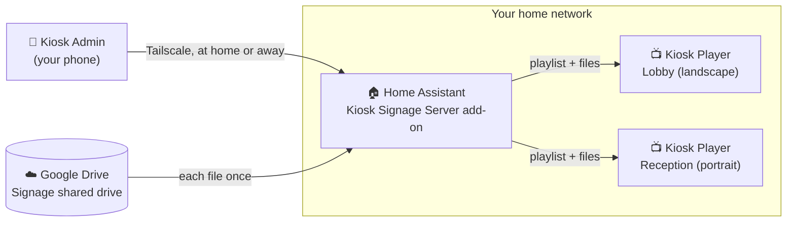
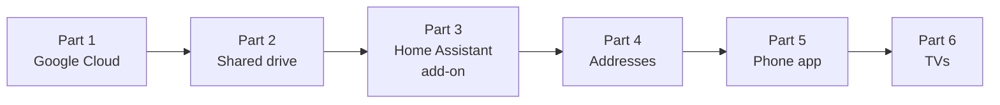
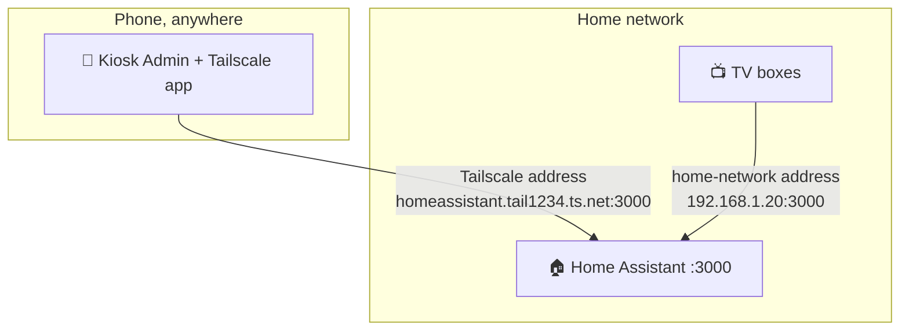
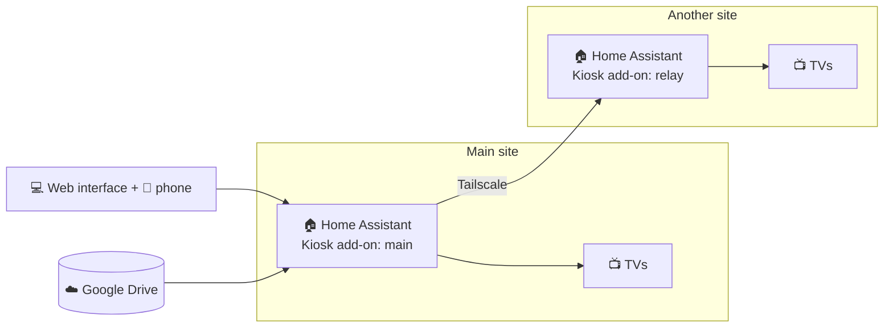

# Kiosk Signage

Digital signage you manage from Home Assistant, a computer, or your phone.

- **Kiosk server** runs as a Home Assistant add-on. It keeps the playlists, screens and users, and passes
  your files from Google Drive to the TVs. It's the one place everything is stored.
- **Web interface, the main control:** in Home Assistant's sidebar, or at `http://<address>:3000` from any
  computer. Every screen at a glance, new TVs waiting to be added, files, playlists, people and settings.
- **Kiosk Admin** runs on your Android phone: the same management on the go.
- **Kiosk Player** runs on Android TV boxes and loops 4K videos and pictures, full screen. It finds the
  server on its own network by itself.
- **Several sites?** One Home Assistant is the main control; the Home Assistants at your other sites
  relay their TVs to it (see [Adding another site](#adding-another-site)).



Your videos and pictures live in a **Google Drive shared drive**. Anything you drop there shows up in the
app's Library. Each TV downloads its playlist and plays from its own storage, so it keeps playing if the
internet drops.

4K videos are kept as they are in Drive. The server also makes smaller copies so a weak Android TV box
can play them smoothly: 1080p H.264 for most boxes, 720p if a box cannot do 1080p, and an optional 4K
HEVC copy for a box that can decode it. Each player reports what it can decode, and downloads the copy
that fits. On a slow Home Assistant machine (a Raspberry Pi), turn **Make playback copies** off.

---

## Setup guide

Allow about an hour the first time. You need:

- a **Google account** whose Drive holds your signage files (a Google Workspace account with a shared drive works best),
- **Home Assistant OS** with the **Tailscale** add-on already working,
- an **Android phone** and one or more **Android TV boxes**,
- a computer, to copy files to Home Assistant.



### Your settings sheet

Fill this in as you go. You'll need these values in Part 3.

| Setting | Where it comes from | Example |
|---|---|---|
| Service account email | Part 1, step 3 | `kiosk-drive@kiosk-signage.iam.gserviceaccount.com` |
| Service account key file | Part 1, step 4 | `service-account.json` (**secret, never share it**) |
| Drive folder ID | Part 2, step 4 | `0AbCdEfGhIjKlMnOpQ` |
| Home network address | Part 4, step 1 | `192.168.1.20:3000` |
| Tailscale address | Part 4, step 2 | `homeassistant.tail1234.ts.net:3000` |

---

### Part 1: Google Cloud (about 10 minutes)

This gives the server a way to read your Drive folder. Signing in to Kiosk doesn't involve Google:
people use a username and password you make in Kiosk (Part 3).

1. **Create a project.** Go to [console.cloud.google.com](https://console.cloud.google.com), open the project
   picker at the top, choose **New project**, name it `Kiosk Signage`, and click **Create**. Make sure the
   new project is selected at the top.
2. **Switch on the Drive API.** Go to **APIs & Services → Library**, search for **Google Drive API**,
   open it, and click **Enable**.
3. **Create the robot account (a "service account").** Go to **IAM & Admin → Service accounts →
   Create service account**, name it `kiosk-drive`, click **Create and continue**, skip the optional
   steps, and click **Done**. Copy its **email** into your settings sheet.
4. **Download its key.** Click the service account, open the **Keys** tab, then **Add key → Create new
   key → JSON → Create**. A `.json` file downloads. Rename it to `service-account.json` and keep it
   somewhere safe: it works like a password to your signage Drive. Never send it to anyone or paste it
   into a chat; if that happens, delete the key here and make a new one.

> **If step 4 says key creation is blocked:** your Workspace has a policy that blocks service account keys.
> A Workspace admin can allow it in Cloud Console under **IAM & Admin → Organization policies →
> "Disable service account key creation"** (`iam.disableServiceAccountKeyCreation`), set for this project only.

### Part 2: The Signage shared drive (about 5 minutes)

1. Go to [drive.google.com](https://drive.google.com), open **Shared drives**, click **New**, and name it
   `Signage`.
2. Open it, click its name at the top, choose **Manage members**, and add the **service account email**
   as a **Content manager**. Untick **Notify people**, then click **Share**.

   

3. If Drive says you **can't share outside your organisation**, open the shared drive's **Settings**
   (the same menu) and allow **people outside your organisation**. If that option is greyed out, a
   Workspace admin can switch it on in **admin.google.com → Apps → Google Workspace → Drive and Docs →
   Sharing settings**.
4. Look at the web address while you're inside the shared drive:
   `https://drive.google.com/drive/folders/`**`0AbCdEfGhIjKlMnOpQ`**. The last part is the **Drive
   folder ID**. Copy it into your settings sheet.
5. Drop one test video (`.mp4`) and one picture (`.jpg` or `.png`) into it.

### Part 3: The Home Assistant add-on (about 10 minutes)

1. **Add the Kiosk add-on repository.** In Home Assistant, go to **Settings → Add-ons → Add-on store**,
   open the **⋮** menu (top right) and choose **Repositories**. Paste this address, click **Add**, then
   **Close**:

   ```
   https://github.com/hybrid87sg/kiosk-addons
   ```

2. **Install it.** Refresh the page, find **Kiosk Signage Server** in the store, open it and click
   **Install**. Home Assistant downloads the add-on ready-made, so this takes about a minute.
3. **Fill in the Configuration tab** with the values from your settings sheet, then click **Save**:

   

   Leave **Mode** as `main`. **Site name** is optional (e.g. `Head office`); it matters once you
   [add another site](#adding-another-site). Leave **Service account key file** as it is.
4. Go back to the **Info** tab, switch on **Start on boot**, **Watchdog** and **Show in sidebar**, and click
   **Start**. The **Log** tab should end with `Kiosk server running on port 3000`.
5. **Add the Google key.** Open **Kiosk Signage** in Home Assistant's sidebar and go to
   **Settings → Google key**. Choose **Upload the file** and pick `service-account.json`, or choose
   **Paste the text** and paste everything that's in the file. The key stays on your Home Assistant and
   is never shown again.
6. **Share the Drive folder with the server.** The same card now shows the service account's email. If you
   haven't already (Part 2, step 2), share your signage folder with that email as **Editor**
   (**Content manager** on a shared drive). Then press **Test connection** under **Google Drive folder**:
   it should say `✓ Connected`.

7. **Make your own username.** Still in Kiosk Signage, go to **Users → Add someone**. Type a username,
   a password of at least 8 characters, and choose **Spongebob** (everything). This is what you sign in
   with on the phone. The sidebar page itself never asks: your Home Assistant login covers it.

> **Prefer a file?** You can instead copy `service-account.json` into the **addon_configs** share (via the
> **Samba share** add-on), in the folder ending in **`_kiosk_server`**. A key added on the Settings page is
> used instead of that file.

### Part 4: The two addresses (about 5 minutes)

Your phone and your TVs reach the server in different ways:



1. **Home-network address (TVs, as a backup).** TVs normally find the server by themselves, and find it
   again if the router gives it a new address. Just in case, in Home Assistant go to
   **Settings → System → Network** and note the **IPv4 address** (e.g. `192.168.1.20`). The address to
   type is that plus `:3000`.
2. **Tailscale address, for the phone.** In the
   [Tailscale admin console](https://login.tailscale.com/admin/machines), find your Home Assistant machine.
   Copy its **MagicDNS name** (e.g. `homeassistant.tail1234.ts.net`) or its `100.x.y.z` address. The
   phone address is that plus `:3000`.
3. **Quick test.** On your phone, with the Tailscale app switched on, open the browser and go to
   `http://homeassistant.tail1234.ts.net:3000/api/health` (using your own name). It should say
   `{"ok":true}`.

### Part 5: The phone app (about 5 minutes)

1. From [**Releases**](https://github.com/hybrid87sg/kiosk-player/releases), download
   `KioskAdmin-for-phone-<version>.apk` (e.g. `KioskAdmin-for-phone-0.11.3.apk`) **on your phone** and open it. Allow **Install unknown apps** when Android
   asks.
2. Open **Kiosk Admin**, enter the **Tailscale address** (e.g. `homeassistant.tail1234.ts.net:3000`),
   then the **username** and **password** you made in Part 3, step 7, and tap **Sign in**.

   

3. **Library** shows your test files, sorted into **Landscape** and **Portrait**.
4. **Add a location**, the place your screens are in, e.g. `Main lobby`: on the web page, **Locations →
   Add location**. It gets two playlists made for it, **Landscape** and **Portrait**, and every screen
   there plays the one that fits how it is mounted. Open **Landscape**, click **Add from library**, then
   **Save playlist**. (On the phone, they are on the **Playlists** tab.)

### Part 6: The TVs (about 5 minutes per TV)

1. Install `KioskPlayer-for-TV-<version>.apk` on the screen itself if it runs Android TV or Google TV (e.g. Xiaomi TVs,
   many SWOSH TVs and commercial displays), otherwise on an Android TV box plugged into it. You can:
   - copy it on a USB stick and open it with a file manager app, or
   - use the **Send Files to TV** app on your phone and the TV, or
   - install it from a computer over ADB (`adb install KioskPlayer-for-TV-0.11.3.apk`, with the version you downloaded).
2. **Let it keep itself on screen.** On Kiosk Player's first screen, choose
   **Allow display over other apps** and switch it on for Kiosk Player. With this, the player starts by
   itself when the box is switched on, and comes back 30 seconds after someone presses Home or opens another
   app. Staff can switch this off, or pick **Leave for 15 minutes**, under **Settings** (press **OK** on
   the remote while it plays).
   - On Google TV the menu is **Settings → Apps → Special app access → Display over other apps**.
   - If your TV box hides that menu, run this from a computer instead:
     `adb shell appops set com.kiosk.player SYSTEM_ALERT_WINDOW allow`

   The same permission lets it **reopen itself if Android closes it** (a crash, or the box running out of
   memory): it checks about once a minute, and is back within a minute or so. It also runs as a media app,
   so Android is less likely to close it in the first place. When it does happen, the screen's card on the
   dashboard says **Closed by itself … and reopened**, with the reason, for a week.

   **Optional: make it the TV's home screen.** Some TV boxes have a "memory cleaner" or "auto-close apps"
   feature that force-stops apps; nothing comes back from that except the home screen app. In Kiosk Player's
   **Settings**, choose **Make it the home screen** and pick Kiosk Player (**Always**). If the TV doesn't
   ask, run `adb shell cmd package set-home-activity com.kiosk.player/.HomeScreen` from a computer. The
   Home button then also leads back to the player: to reach the box's own settings, use **Leave for 15
   minutes**, then **Open TV settings**. **Stop being the home screen** undoes it. Better still, switch the
   cleaner off in the box's settings if it lets you.

   **Optional: let it switch the screen off after hours.** In Kiosk Player's **Settings**, choose
   **Allow turning the screen off** and confirm. Outside the location's working hours the player then puts
   the TV into standby where it can, and wakes it at opening time (see
   [Working hours](#working-hours-and-after-hours)). If the TV hides that screen, run from a computer:
   `adb shell dpm set-active-admin com.kiosk.player/.ScreenOffAdmin`

   **Let the dashboard update the app (recommended).** In Kiosk Player's **Settings**, choose **Allow
   installing updates** and switch on **Install unknown apps** for Kiosk Player. From then on, new versions
   come from the dashboard (**Update app** on the screen's card), so this is the last time you install it
   by hand. If the TV hides that screen, run from a computer:
   `adb shell appops set com.kiosk.player REQUEST_INSTALL_PACKAGES allow`
3. **Portrait TV?** Press **Turn picture** until the text is upright. The TV remembers it, and the dashboard's
   **Add** dialog starts with it.
   Choose **Find my server automatically**. After a few seconds the TV shows a big **QR code** and a
   **code**. (If it finds nothing, choose **Type the address** and enter the home-network address from
   Part 4, e.g. `192.168.1.20:3000`.)
4. On the web interface (**Kiosk Signage** in Home Assistant's sidebar), the TV appears under
   **New screens waiting** with its model name and code. Click **Add**, then set it up:
   - its **name** and its **location** (required: that is where its playlist and working hours come from),
   - **how the screen is mounted**: landscape, landscape upside down, portrait turned left or right, or
     **portrait, already upright**. Use that last one for tall signage displays (for example Rockchip
     stands) that already show their own menus upright: the TV app turns nothing, and the screen plays
     Portrait playlists. If the picture comes out sideways on such a display, this is the setting to pick.
   - its **playlist**. Leave it on **Automatic** and the screen plays its location's Landscape or
     Portrait playlist, whichever fits. Or choose **any playlist** for just this screen: the location's
     own Landscape, Portrait or extra playlists, or (under **Show playlists from other locations**)
     another location's. Choose **Automatic** again to go back.

   Click **Add screen**. On your phone, **Players** shows the same **New TVs waiting** list; you can also
   **Scan QR code** or **Enter code instead**.
5. The TV shows **Getting content ready**, downloads its files, and starts playing.

### The web interface (the main control)

Everything you can do in the phone app, and more, from any computer. There are two ways in:

| Where | Who can use it | How to sign in |
|---|---|---|
| **Kiosk Signage** in Home Assistant's sidebar | Home Assistant admins (as Spongebob) | Already signed in through Home Assistant |
| `http://<address>:3000` in any browser. The add-on's **Open web UI** button opens it too. | Anyone you made a user for, with their role. They don't need a Home Assistant account. | **Sign in** with their Kiosk username and password. |

**Which address?** At home, the home-network address (`http://192.168.1.20:3000`). Away from home, the
Tailscale address (`http://homeassistant.tail1234.ts.net:3000`). For someone outside your network, install
the **Tailscale** app on their computer, then in the
[Tailscale admin console](https://login.tailscale.com/admin/machines) open your Home Assistant machine's
**⋯** menu, choose **Share…**, and invite their email. They can reach the Kiosk web page, but they still
can't get into Home Assistant itself without a Home Assistant login.

What's on it:
- **Screens:** every TV at a glance (online or offline, what's playing, download progress, free storage,
  app and Android version), updated every 10 seconds and grouped by location, with each location's working
  hours. New TVs appear under **New screens waiting**; click **Add**. **Add by code** is there too.
  On every screen's card (0.13.0, for Spongebob and Patrick):
  - **See screen** shows a picture of exactly what the screen shows right now, taken when you press it.
    The screen gets the request at its next check-in, so the picture takes up to a minute. Only the latest
    picture of each screen is kept, and only people who manage screens can see it.
  - **Restart** → **Restart app** closes Kiosk Player (or Kiosk Browser) and opens it again: it fixes most
    stuck screens and takes a few seconds. **Restart device** restarts the whole TV box or PC. Windows PCs
    can always do it. Android only allows it when Kiosk Player is the box's *device owner* (see
    [Restart device on Android](#restart-device-on-android)), so on most boxes it's greyed out. A restart
    the screen doesn't pick up within 10 minutes (it was off) is dropped, so it never restarts by surprise later.
  - Both need the 0.13.0 apps on the screen; older ones show the buttons greyed out.

  For Spongebob only:
  - **Reset sync** makes the TV download every file in its playlist again, from scratch. It keeps playing
    what it has meanwhile, then switches to the fresh copy and deletes the old files. (Without room for
    both, it deletes first and shows **Getting content ready** until the files are back.)
  - **Update app** installs the Kiosk Player that came with the add-on, and **Update all screens** does every
    screen that can take it. On Android 12 and newer the TV installs it by itself (after the first time);
    on older TVs someone presses **Install** on the TV. The card shows each step. A TV with an app from
    before 0.11.0 needs 0.11.0 installed by hand once.
  - **Windows PCs update themselves** (0.13.0): a PC with an older Kiosk Browser downloads the new one from
    your Kiosk server and installs it **outside working hours** (a location that's always open: between 3
    and 5 in the morning), so no customer sees it. **Update app** on its card does it now instead, as soon as
    nobody is using the kiosk. The PCs only talk to your Kiosk server; the server fetches the installer
    once from the GitHub release of its own version (a few minutes after a release, the Windows installer
    is built last).
- **Locations:** one block per location, with its **playlists**, its **working hours** and its screens.
  Every location is also listed in the side menu; open one to rename it or **move a screen here**.
  **+ Add location** makes a new one.
  **Delete location** asks you to type the location's name, and only works once no screens are left in it.
- **Library:** files come from Google Drive. Put them in the Signage folder, then press **Sync with Drive**.
  - **Show from / until:** click a file's calendar button to choose the
    first and last day it shows. Before the first day it waits in the library (TVs download it a day early,
    so it starts on time). After the last day it leaves Kiosk, every playlist and every screen by itself.
  - **Remove** takes a file out of Kiosk straight away.
  - Expired and removed files wait under **Expired and removed**, where **Restore** brings them back.
  - **Kiosk never deletes anything from Google Drive.** Removed and expired files stay in the shared drive;
    tidy it up there yourself whenever you like.
- **Playlists** live under **Locations**. Each location has an automatic **Landscape** and **Portrait**
  playlist that its screens follow by themselves, plus any **extra playlists** you add for a screen that
  should show something different. The automatic two can't be renamed or deleted; you change what's in
  them. Locations are one list for all your sites: a screen is in a location whichever Home Assistant it
  connects through. A playlist that belongs to no location (from an older version, or left by a deleted
  location) is listed under **Playlists without a location**, to move or delete.
- **In a playlist:** drag rows to reorder them, and optionally set an inclusive start/end date window for each file.
  Dates use the browser's local timezone; players include files only during that window.
- **Settings** (Spongebob): pick who gets **notifications** when a screen goes offline, change the Drive
  folder and test the connection, switch local copies on or off and clear them, and check which sign-in
  methods are set up.
  - **Sound:** **Play videos with sound** is off by default, for every screen: videos play silently whatever
    the TV's volume is, and the playback copies are made without sound. Your files in Google Drive keep
    their sound. Turn it on and the copies are made again with sound; screens keep the silent ones until then.

The **‹** button next to the name folds the side menu down to icons; it's remembered in that browser.

**Light or dark:** the switch at the bottom of the side menu picks **Light** (cream), **Dark** (warm brown, like
the TVs) or **Automatic** (follows the computer's own setting). Each browser remembers its choice.

### Working hours and after hours

Each location can have working hours (Locations → a location → **Working hours**): opening and closing
times per day, days it's closed, or **Always on**. A closing time earlier than the opening time runs past
midnight (e.g. 18:00 to 02:00). Each TV uses its own clock, so it keeps to the hours even if the internet
drops.

Outside working hours the screens show **black**, and where possible go into **standby**:

| Your screen | What to do |
|---|---|
| **Xiaomi TV** (Android TV / Google TV built in) | Install Kiosk Player on the TV. Allow **turning the screen off** (Part 6, step 2); many such TVs then go into standby after hours. |
| **SWOSH TV** | If its home screen says Google TV or Android TV, as for Xiaomi. If not, plug in an Android TV box (e.g. Xiaomi Mi Box) and use the box. |
| **Commercial display** | If it can install apps (Android inside), install directly. For real power saving, also set the display's own **on/off timer** in its menu to match the working hours. |
| **Any TV with an Android TV box** | Allow **turning the screen off** on the box, and switch on **HDMI-CEC** on the TV (Samsung: Anynet+, LG: SIMPLINK, Sony: BRAVIA Sync, others: CEC). The TV then follows the box into standby and back on. |

Screens that can't go into standby simply stay black after hours. Screen cards show **After hours ·
standby** or **After hours · black screen** so you can see which is which.

### Notifications when a screen goes offline

Home Assistant can tell your phone when a screen stops working:

1. Install the **Home Assistant** app on your phone and sign in to your Home Assistant. (It adds a
   `notify.mobile_app_…` service for the phone.)
2. In the Kiosk web interface, go to **Settings → Notifications**, tick your phone (and anyone else's), and
   click **Send a test notification**.

You get one notification when a screen has been offline for **5 minutes during its location's working
hours** (several at once are grouped; a whole site going quiet is reported as that site), and another
when it's **back online**. Nothing is sent outside working hours. Tapping it opens Kiosk Signage in the
Home Assistant app.

### Adding another site

Have Home Assistants at other places too? Keep **one** of them as the main control. At each other site,
the Kiosk add-on runs as a **relay**: that site's TVs talk to their own Home Assistant, which passes
everything on to the main one over Tailscale. Every screen, at every site, shows up in the one web
interface, and you use one user list, one library and one list of locations. Each location has its own
Landscape and Portrait playlist, so two places can show different things.



Each video crosses the internet once per site. The relay keeps its own copy and sends it to that site's
TVs over the local network. If a site's internet goes down, its TVs keep playing what they have.

1. **On the main Home Assistant:** in the Kiosk add-on's **Configuration** tab, set **Site name**
   (e.g. `Head office`). Note its Tailscale `100.x.y.z` address
   ([admin console](https://login.tailscale.com/admin/machines)).
2. **Make the relay on the main server.** In the web interface: **Settings → Home Assistant Relays →
   Add relay**. Give it the site's name (e.g. `Orchard branch`). You get a **pairing code** like
   `ABCDE-23456`. It works once in each place below, for 10 minutes; press **Pairing code** on the relay
   for a new one at any time.
3. **At the new site, install Tailscale.** Install the **Tailscale** add-on in that site's Home Assistant
   and log in with the **same Tailscale account** as the main site. Sharing a machine in from a different account isn't enough: a shared machine can't start connections, and a relay has to. In the Tailscale add-on's **Configuration**, turn
   **userspace networking** off, so other add-ons can use Tailscale too, then restart it.
4. **Install the Kiosk add-on there** (Part 3, steps 1–2). You don't need the Google settings or the key
   file there. In **Configuration**, set:
   - **Mode**: `relay`
   - **Site name**: the same name as the relay, e.g. `Orchard branch`
   - **Main server address**: the main Home Assistant's Tailscale address plus `:3000`,
     e.g. `100.101.102.103:3000`
   - **Pairing code**: the code from step 2
5. **Start it.** Its sidebar page shows **Paired as Orchard branch** and **Connected**.
6. **Optional: the Kiosk Player integration**, to see and control this site's screens in its own
   Home Assistant (a device per screen, playlist choice, refresh, and automations). In HACS:
   **⋮ → Custom repositories** → `https://github.com/hybrid87sg/kiosk-player-ha`, type **Integration**,
   download **Kiosk Player**, restart Home Assistant. Then **Settings → Devices & services → Add
   integration → Kiosk Player**: the main server's Tailscale address and the same code (make a new one
   if 10 minutes have passed). Examples of what to do with it: [docs/ha-examples.md](docs/ha-examples.md).
7. **Add that site's TVs** as in Part 6. They find their local relay by themselves, and appear on the main
   web interface under **New screens waiting**, labelled with the site. They belong to that relay.
8. **When every relay is paired**, switch on **Only accept relays that have paired** (Settings → Home
   Assistant Relays). From then on nothing on your network can pretend to be one of your sites.

Each relay controls only its own screens: one site's Home Assistant can't see or change another
site's. The main server's web interface still shows and controls everything.

#### Upgrading relays from before 0.7.0

Relays set up before 0.7.0 keep working after the update, without a pairing code. On the main server
they appear under **Settings → Home Assistant Relays**, named after their site and marked
**Waiting to pair**, with their TVs already assigned. To pair one: **Pairing code**, then steps 4–6
above (only the **Pairing code** box is new in the add-on). Update the main add-on first, then the relays.

Back up first: **Settings → System → Backups → Back up now** on the main Home Assistant. The update
only adds to the database (screens, users, playlists and files stay as they are), and 0.6.0 can still
open it if you ever need to go back.

#### If a site's Home Assistant is lost, stolen or reset

On the main server, **Settings → Home Assistant Relays**, on that relay:

1. **Revoke…** its credentials. Its add-on and integration are refused at once. Its TVs keep playing
   what they have; they are not removed.
2. **New pairing code**, then put it in the add-on's **Pairing code** option (restart the add-on) and,
   if you use the integration, in the **Reconfigure** form Home Assistant shows for Kiosk Player.
   The same TVs come back without being added again.

To stop a site entirely, **Disable** the relay instead; **Enable** brings it back.

### Public dashboard: the web page on the internet, with Google sign-in (optional)

At home or over Tailscale the web page asks for a username and password. If you also want it on
the internet, for people without Tailscale, Kiosk can put it at its own https address such as
`https://kiosk.your-tailnet.ts.net`. There, people sign in **only with a Google account you link to
their user**; passwords don't work there. Screens, relays and files are never reachable that way:
only this web page.

It works through **Tailscale Funnel**, run by the Kiosk add-on itself (Home Assistant's own
Tailscale add-on can only put Home Assistant on the internet, not Kiosk). About 20 minutes, once.

**A. Tailscale (admin console: <https://login.tailscale.com/admin>)**

1. **DNS** page: make sure **MagicDNS** is on, and turn on **HTTPS Certificates**.
2. **Settings → Keys → Generate auth key**. Leave it single-use. Copy the key (`tskey-auth-…`).
   Keep it private, like a password.
3. In Home Assistant, the Kiosk add-on's **Configuration** tab:
   - **Public dashboard**: on
   - **Public dashboard name**: `kiosk` (the address becomes `https://kiosk.<your-tailnet>.ts.net`)
   - **Tailscale auth key**: paste the key

   Then **Save** and restart the add-on. A machine called `kiosk` appears in your Tailscale admin console.
4. Open Kiosk Signage → **Settings → Public dashboard**. It either shows the address, or says what's
   missing, with a button: usually **Open Tailscale to allow it**, which lets you allow Funnel for
   this machine (sign in as the Tailscale account owner). Kiosk tries again every minute. The key
   is only needed once; you can delete it from the add-on's options afterwards.

**B. Google (the same Google Cloud project as Part 1)**

1. <https://console.cloud.google.com/apis/credentials/consent>: **OAuth consent screen**. Choose
   **External**, give the app a name (e.g. `Kiosk Signage`) and your email, save. Under **Audience**
   (or **Test users**), either add the Google accounts that will sign in, or **Publish app** (signing
   in only asks for name and email, which needs no review by Google).
2. **Credentials → Create credentials → OAuth client ID → Web application**. Name: `Kiosk dashboard`.
   Under **Authorized JavaScript origins**, add the address from A4, e.g.
   `https://kiosk.your-tailnet.ts.net` (no slash at the end). **Create**, and copy the **Client ID**
   (`…apps.googleusercontent.com`).
3. Kiosk Signage → **Settings → Public dashboard → Google web client ID**: paste, **Save**.

**C. Who may sign in**

On **Users**, press **Link Google** next to each person and enter their Google account (e.g.
`patrick@gmail.com`). Signing in with it gives that user's role. **Unlink** stops it at once. A
Google account that isn't linked is refused. Their username and password keep working at home and
in the phone app.

The first time someone signs in with Google, Kiosk remembers **that exact Google account**, not just
its email address. So if the address later passes to someone else (a work address given to a new
member of staff, or a lapsed domain), the new account is refused. If a person really did get a new
Google account with the same address, **Unlink** and **Link Google** again; their next sign-in is
remembered instead.

To protect the internet address, each visitor gets 10 Google sign-in attempts a minute, and the browser
is told to run only Kiosk's own code and Google's sign-in button. Signed-in sessions are stored scrambled
(like passwords), so a copy of a Home Assistant backup can't be used to sign in.

### Video Kiosk or Web Kiosk: what a screen does (0.12.0)

Every screen is one of two kinds, chosen under **Screens → Edit → What this screen does**:

| | While nobody touches it | When someone touches it |
|---|---|---|
| **Video Kiosk** | Plays its playlist | Nothing |
| **Web Kiosk** | Plays its playlist, with *Touch the screen to start* | Opens **your web page** (a shop, a menu, a check-in form). After the time you set untouched, or **Start over**, everything they did is wiped and the playlist comes back |

Android screens start as **Video Kiosks**; Windows PCs (Kiosk Browser, below) start as **Web Kiosks**.
Both can be either. A Web Kiosk's settings: the **web address**, **back to the playlist after**
(seconds untouched), **other websites customers may open**, and a **staff PIN**. Customers stay on
your website (and the ones you list); downloads, pop-up windows, choosing files, the camera,
microphone and location are refused.

**An Android screen as a Web Kiosk** needs:

- **Kiosk Player 0.12.0 or newer** on it. Update it from the dashboard (**Update app** on its card) or
  install `KioskPlayer-for-TV-<version>.apk` by hand. The choice is greyed out until it has it.
- **A touchscreen**, such as a touch signage stand. The screen reports whether it has one; the
  dashboard warns if it doesn't.
- **A working web viewer** (*Android System WebView*). Most screens have one; cheap TV boxes sometimes
  have an old one. The dashboard shows a warning if it's missing or old; update it from the Play Store.
- Easiest for a touch stand: **How the screen is mounted → Automatic: follow this screen** (Kiosk
  Player 0.12.1 or newer). Android turns the screen itself (with its rotation sensor, or its own display
  setting), Kiosk Player turns nothing, and the playlist follows the shape the screen reports: Portrait
  when it's tall, Landscape when it's wide. Turn a stand that has a rotation sensor and it switches within
  seconds. The choice is greyed out for older apps, for a screen that hasn't checked in yet, and for
  Windows PCs (turn those in Windows' own display settings).
- Or set **How the screen is mounted** to **Portrait, already upright**. If its
  Android runs sideways (the home screen looks turned), first turn it in Android itself: **Settings →
  Display → rotation** (on Rockchip stands sometimes "Screen rotation" or "HDMI rotation"). Kiosk Player
  can turn its own picture (*Portrait, turned right/left*), and since 0.12.1 the web page and the staff
  corner follow it, but Android's on-screen keyboard can't be turned by an app and would come up
  sideways. The dashboard warns about this.

**Staff on an Android screen:** tap the **top-left corner 5 times quickly**, then type the staff PIN,
to open Kiosk Player's settings (and from there, Android). This also works on a Video Kiosk with a
touchscreen once a PIN is set; without a PIN, a Video Kiosk ignores touches completely. A TV remote's
**OK** button still opens settings as before.

### Windows web kiosk: Kiosk Browser (optional)

A Windows PC with a touch screen can be a **web kiosk**: while nobody uses it, it plays its playlist
like a TV; when a customer touches it, it opens **your web page** (a shop, a menu, a check-in form).
Customers can only use that website (and sites you allow). After the time you set untouched, or when
they tap **Start over**, everything they did is wiped (cookies, logins, what they typed) and the
signage comes back for the next person.

**Install it (once per PC)**

> **Upgrading a PC from 0.12.x or older:** first uninstall the old one (*Settings → Apps → Installed apps →
> Kiosk Browser → Uninstall*), then install 0.13.0 as below. It stays paired and keeps its files. This is the
> last time: from 0.13.0 on, the PC updates itself (see **Screens** above). 0.13.0 installs just for the
> Windows user that runs it, so updates never need an administrator to click "Yes".

1. Download `KioskBrowser-Setup-<version>.exe` from the latest release
   (<https://github.com/hybrid87sg/kiosk-player/releases>) and run it. Windows warns **"Windows
   protected your PC"** because the app isn't signed with a paid certificate: click **More info → Run
   anyway**.
2. It opens full screen. Tap **Find the Kiosk server** (or type the Home Assistant's address, e.g.
   `192.168.1.20`). At another site, choose that site's relay.
3. It shows a code. On the Kiosk web page: **Screens → New screens waiting → Add** (it's listed as
   *Windows kiosk*). Give it a name and location as for a TV, then the **Web Kiosk** part:
   - **Web address**: the page customers start on, e.g. `https://shop.example.com/start`
   - **Back to the playlist after**: seconds untouched (90 is a good start)
   - **Other websites customers may open**: e.g. a payment page on another site; one per line
   - **Staff PIN**: 4 to 8 digits

Changes on the dashboard reach the PC within a minute. Working hours apply as for TVs: outside
them the screen is black and touches do nothing.

**Staff:** tap the **top-left corner 5 times quickly**, then type the PIN, for: *Check for new
content now*, *Leave the kiosk for 15 minutes* (to use Windows), *Forget the server and pair again*,
or *Quit*. The PIN keeps curious customers out; it isn't strong security, so don't reuse a password.

**Set the PC up as a kiosk (recommended)**

- **Sign in automatically**: a kiosk PC should start straight into Kiosk Browser after a power cut.
  Use a separate local Windows account for it, and turn on automatic sign-in (search "netplwiz", or
  *Settings → Accounts → Sign-in options*). Kiosk Browser starts by itself when Windows does.
- **Touch keyboard**: *Settings → Time & language → Typing → Touch keyboard → Show the touch keyboard*:
  **Always** (or "when there's no keyboard attached").
- **Never sleep**: *Settings → System → Power*: screen and sleep **Never** (Kiosk Browser also keeps the
  screen awake during working hours).
- **Windows Update**: set *Active hours* to your opening hours, so it doesn't restart while open.
- **Rotation**: for a portrait screen, set it in *Settings → System → Display → Display orientation*.

### Restart device on Android

Android lets an app restart the whole TV box only if the app is the box's **device owner**. This is
optional: **Restart app** works without it. To set it up (once, with a computer and a USB cable or
network adb; the box must have **no Google account** signed in):

```
adb shell dpm set-device-owner com.kiosk.player/.ScreenOffAdmin
```

After that, **Restart device** on the screen's card works for that box. To undo it, uninstall Kiosk Player
or reset the box.

### Adding other people

In the web interface, go to **Users → Add someone** and choose how they sign in:

- **Google account:** type their Gmail address and pick a role. They can sign in with **Sign in with Google**
  on the [public dashboard](#public-dashboard-the-web-page-on-the-internet-with-google-sign-in-optional)
  straight away, with no password. Their username is made from the address. Give them a password later
  (**Set password**) if they also need the phone app or the home address.
- **Username and password:** a **username**, a **password** of at least 8 characters, and a role. Kiosk
  Admin on the phone can add people this way too.

The roles:

| Role | Can do |
|---|---|
| **Spongebob** | Everything, including people and roles |
| **Patrick** | Players and content |
| **Squidward** | Files and playlists |

Tell them their username and password yourself; Kiosk keeps passwords scrambled and can't show one
again. They can use the web interface from their computer (see above), or install the phone app the
same way, connect with Tailscale, and sign in.

- **Forgotten password:** Spongebob gives them a new one under **Users → New password**. If Spongebob's
  own is forgotten, open Kiosk Signage from Home Assistant's sidebar (which needs no Kiosk password) and
  set a new one there.
- **Five wrong passwords** lock that username for five minutes.
- **Removing someone** signs them out straight away.
- On the same Wi-Fi as the server, passwords travel unencrypted, as with most home-network devices. Over
  Tailscale they are encrypted. Use passwords you don't use anywhere else.

### Troubleshooting

| What you see | What to do |
|---|---|
| Add-on log: `Missing settings: …` | Fill in those boxes on the **Configuration** tab, then **Save** and **Start**. |
| Library is empty, or says `The Google key hasn't been added yet` | Add the key under **Settings → Google key** (upload or paste). |
| Library says `Google can't find the Drive folder` | Check the folder ID under **Settings**, and share the folder with the email shown on the **Google key** card, as **Editor**. |
| Phone: "Can't reach the server" | Is the Tailscale app on? Does `…:3000/api/health` open in the phone's browser? |
| Phone: "This server is older than this app" | Update the Kiosk add-on in Home Assistant to 0.6.0 or newer. |
| Phone or web: "Wrong username or password" | Usernames are lower case. Spongebob can set a new password under **Users → New password**. |
| "Too many wrong passwords" | Wait five minutes, or have Spongebob set a new password, which clears it. |
| A screen shows nothing and says "No location yet" | Edit the screen and choose its location; its playlist comes from there. |
| Library says "Could not reach Google Drive" | Check the Drive folder ID, and that the service account is a **Content manager** on the shared drive. |
| A screen is black during the day | Check its location's **working hours** (Locations), and that the TV's clock and time zone are right. |
| A TV doesn't wake up at opening time | Allow **turning the screen off** again in Kiosk Player's Settings, switch on HDMI-CEC on the TV (with a box), or use the display's own on/off timer. You get a notification 5 minutes after opening if it stays offline. |
| No offline notifications | **Settings → Notifications**: tick a device and **Send a test notification**. The phone needs the Home Assistant app, signed in. |
| Can't delete a location | Move its screens to another location first, and type its name exactly. |
| A file disappeared from the library or the screens | It probably expired or was removed: see **Library → Expired and removed**, and **Restore** it. |
| A file shows **Checking shape…** | Drive is still processing a new video; it sorts itself within a few minutes. |
| TV says "No server found" | Is the Kiosk add-on running, and is the TV on the same network as Home Assistant (not a guest Wi-Fi)? Or choose **Type the address**. |
| TV shows "Can't reach the server" | If you typed an address, it must be the **home-network** one, not the Tailscale one. The TV also searches again by itself after 2 minutes. |
| Relay page says it can't reach the main server | The page says which it is. **No answer:** both Home Assistants must be in the **same Tailscale account** (a machine that was only *shared* in from another account can't start connections), both online in Tailscale, and userspace networking off in the relay site's Tailscale add-on. **Nothing listening:** start the Kiosk add-on at the main site; the address is the main site's Tailscale address plus `:3000`. |
| Relay page: **Not paired** | Make a code on the main server (**Settings → Home Assistant Relays → Pairing code**), put it in the add-on's **Pairing code** option, **Save**, restart the add-on. |
| Relay page: **That pairing code isn't valid** | The code was mistyped, already used by the add-on, or more than 10 minutes old. Make a new one. |
| Relay page: **no longer accepts this relay's credential** | It was revoked on the main server. Pair it again with a new code (see *If a site's Home Assistant is lost*). |
| Relay page: **disabled on the main server** | **Enable** the relay under **Settings → Home Assistant Relays**. |
| TVs at a site say "Can't reach the server" after switching on **Only accept relays that have paired** | That site's relay isn't paired yet. Pair it, or switch the setting off until it is. |
| Kiosk Player integration asks to **Reconfigure** | The main server revoked its credential or the relay is disabled. Enter a new pairing code. |
| Kiosk Player: **Main server connected** is off | The site can't reach the main server: same checks as "Relay page says it can't reach the main server". It reconnects by itself. |
| Public dashboard: **Needs a key** / **Key refused** | Make a new auth key in Tailscale (**Settings → Keys**), put it in the add-on's **Tailscale auth key** option, restart the add-on. |
| Public dashboard: **Needs Funnel** or **Needs HTTPS** | Press **Open Tailscale to allow it** on that card, signed in as the Tailscale account owner. Kiosk tries again every minute. |
| Public address: "Google sign-in isn't set up yet" | Paste the Google web client ID under **Settings → Public dashboard** (part B). |
| Public address: Google says the **origin isn't allowed** (error 400) | In Google Cloud, the client's **Authorized JavaScript origins** must be exactly the address shown under Settings, starting `https://`, with no slash at the end. Changes there can take a few minutes. |
| Public address: "This isn't the Google account that was linked" | Kiosk remembers the Google account used the first time. If it's the right person with a new Google account, press **Unlink** then **Link Google** on **Users** again. |
| Public address: "… isn't linked to a Kiosk user" | On **Users**, press **Link Google** for that person and enter exactly that Google account. |
| Public address: Google says "access blocked" or "app not verified" | In Google Cloud's consent screen, add that account as a test user, or **Publish app**. |
| Kiosk Browser: "Windows protected your PC" when installing | It isn't signed with a paid certificate. Click **More info → Run anyway**. |
| Web Kiosk choice greyed out for an Android screen | Its Kiosk Player is older than 0.12.0. Press **Update app** on its card (or install the new APK by hand), then try again. |
| Android Web Kiosk: "This screen can't show web pages" | Android System WebView is missing or switched off. Install or update it from the Play Store, or turn it on under Settings → Apps. |
| Android Web Kiosk: touching does nothing | The screen has no touchscreen (the dashboard says so), or it's set to **Video Kiosk**. |
| Kiosk Browser: "That page isn't available on this kiosk" | The link goes to another website. Add that site under **Other websites customers may open** (Screens → Edit). |
| Kiosk Browser: "No web address yet" | Screens → Edit that kiosk → **Web address**. |
| Kiosk Browser: no on-screen keyboard | Windows *Settings → Time & language → Typing → Touch keyboard*: show it **Always**. |
| Kiosk Browser: forgot the staff PIN | Set a new one on the dashboard (Screens → Edit); the PC picks it up within a minute. |
| HACS: "Repository not found" for kiosk-player-ha | Type it exactly: `https://github.com/hybrid87sg/kiosk-player-ha`, category **Integration**. |
| Phone: "This is the relay for …" | Sign in with the **main** Home Assistant's address; relays only serve their TVs. |
| Pairing screen sideways on a portrait TV | Press **Turn picture** (with the remote) until the text is upright. |
| **See screen** says the screen didn't send a picture | It's off, offline, or its app is older than 0.13.0. A screen asleep after hours sends a black picture or says it's in standby. |
| **Restart app** says Kiosk Player couldn't reopen itself | On the TV, in Kiosk Player's **Settings**, switch on **Come back to the front automatically** (it asks for *Display over other apps*), or make Kiosk Player the home screen. |
| A Windows PC doesn't update itself | It needs Kiosk Browser 0.13.0 or newer, installed by hand once. Its card says what it's waiting for; right after a release the server may still be fetching the installer (it tries again every 30 minutes). |
| **Update app** fails | The card says why. *Install unknown apps*: allow it in Kiosk Player's **Settings** on the TV. *Cancelled on the TV*: someone pressed Cancel, or nobody pressed **Install** in time; press **Update app** again. |
| TV doesn't come back after Home, or doesn't start after a power cut | Give Kiosk Player the **Display over other apps** permission (Part 6, step 2), and check **Settings → Come back to the front** is on. |
| Screen card says **Closed by itself … and reopened** | The reason is shown with it. *Free memory* or *ran out of memory*: the box is short of memory, so close other apps on it or use smaller videos. *Force-stopped*: a cleaner app on the box closed it; switch that off, or make Kiosk Player the home screen (Part 6, step 2). *Crashed*: send us the text. |

---

## For developers

| Folder | What's inside |
|---|---|
| [`server/`](server) | Node.js + Express + SQLite API (`npm test` runs the end-to-end tests) |
| [`homeassistant/`](homeassistant) | The Home Assistant add-on; `package-addon.sh` builds the add-on folder |
| [`homeassistant/integration/`](homeassistant/integration) | The Kiosk Player integration for relay sites (`pytest`, against the real server); `package-integration.sh` builds the copy for [kiosk-player-ha](https://github.com/hybrid87sg/kiosk-player-ha) |
| [`docs/multi-relay/`](docs/multi-relay) | How relays work: plan, API, and the checklist for real installations |
| [`windows/`](windows) | Kiosk Browser for Windows (Electron): `npm test` (core, against the real server), `npm run e2e` (the whole app), `npm run dist` (installer) |
| [`android/`](android) | `core` (shared Kotlin, `./gradlew :core:test`), `admin` (phone app), `player` (TV app) |
| [`.github/workflows/`](.github/workflows) | Builds and checks on every push; **Release** publishes the APKs, the add-on and the Windows installer |

**To publish a release:** go to **Actions → Release → Run workflow** and enter a version (e.g. `0.4.0`).

The APKs are test builds signed with the shared test key in `android/keystore`. Make a private
release key before publishing anywhere public.
