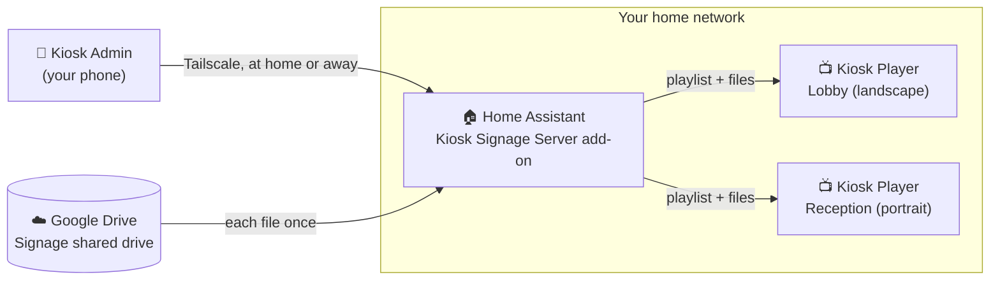
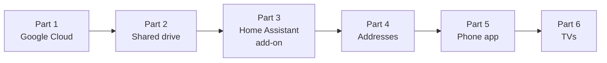
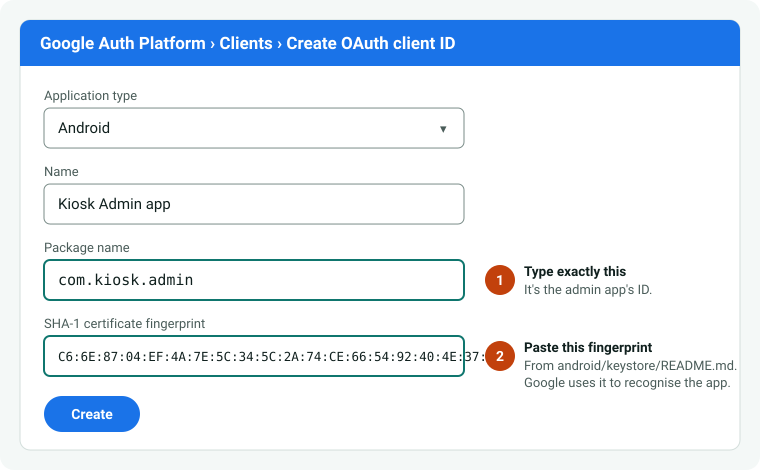
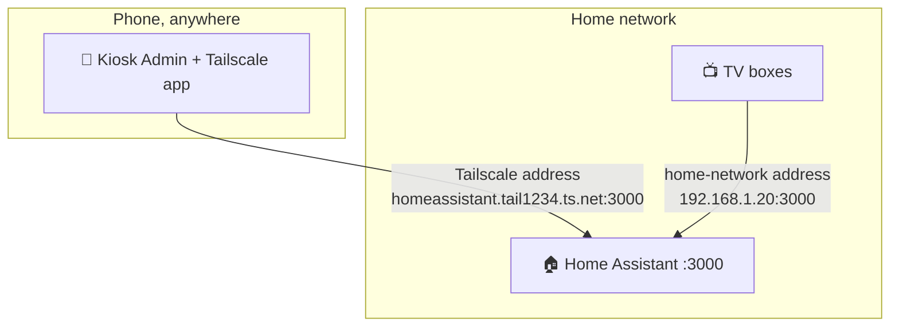

# Kiosk Signage

Digital signage you manage from your phone.

- **Kiosk Player** runs on Android TV boxes and loops 4K videos and pictures, full screen.
- **Kiosk Admin** runs on your Android phone. You pick what plays on which screen.
- **Kiosk server** runs as a Home Assistant add-on. It keeps the playlists, screens and users, and passes your files from Google Drive to the TVs.

Your videos and pictures live in a **Google Drive shared drive**. Anything you drop there shows up in the
app's Library. Each TV downloads its playlist and plays from its own storage, so it keeps playing if the
internet drops.

---

## Setup guide

Allow about an hour the first time. You need:

- a **Google Workspace** account (your company's Google account),
- **Home Assistant OS** with the **Tailscale** add-on already working,
- an **Android phone** and one or more **Android TV boxes**,
- a computer, to copy files to Home Assistant.

### Your settings sheet

Fill this in as you go. You'll need these values in Part 3.

| Setting | Where it comes from | Example |
|---|---|---|
| Superadmin email | Your Google Workspace account | `you@yourcompany.com` |
| Web client ID | Part 1, step 5 | `1234…-abc….apps.googleusercontent.com` |
| Service account email | Part 1, step 7 | `kiosk-drive@kiosk-signage.iam.gserviceaccount.com` |
| Service account key file | Part 1, step 8 | `service-account.json` (**secret, never share it**) |
| Drive folder ID | Part 2, step 4 | `0AbCdEfGhIjKlMnOpQ` |
| Home network address | Part 4, step 1 | `192.168.1.20:3000` |
| Tailscale address | Part 4, step 2 | `homeassistant.tail1234.ts.net:3000` |

---

### Part 1: Google Cloud (about 20 minutes)

This tells Google about your apps, so people can sign in with Google and the server can use Drive.
Do it while signed in with your **Workspace** account.

1. **Create a project.** Go to [console.cloud.google.com](https://console.cloud.google.com), open the project
   picker at the top, choose **New project**, name it `Kiosk Signage`, and click **Create**. Make sure the
   new project is selected at the top.
2. **Switch on the Drive API.** Go to **APIs & Services → Library**, search for **Google Drive API**,
   open it, and click **Enable**.
3. **Set up sign-in.** Go to **Google Auth Platform** (it's also linked from **APIs & Services → OAuth
   consent screen**) and click **Get started**:
   - **App name:** `Kiosk Admin`. **User support email:** your email.
   - **Audience:** **Internal**. Only people in your Workspace can sign in, and Google doesn't need to
     review the app.
   - **Contact information:** your email. Agree, then click **Create**.
4. **Open Clients.** In **Google Auth Platform → Clients**, click **Create client**.
5. **Create the Web client, used by the server.** Choose **Web application** as the application type,
   name it `Kiosk server`, and click **Create**. You don't need to add any URIs. Copy the **Client ID**
   (it ends in `.apps.googleusercontent.com`) into your settings sheet. You don't need the client secret.
6. **Create the Android client, used by the phone app.** Click **Create client** again and choose
   **Android**:

   

   - **Package name:** `com.kiosk.admin`
   - **SHA-1 certificate fingerprint:** `C6:6E:87:04:EF:4A:7E:5C:34:5C:2A:74:CE:66:54:92:40:4E:37:26`
     (the test key in [`android/keystore`](android/keystore/README.md)).
   - Click **Create**. There's nothing to copy from this one.
7. **Create the robot account (a "service account").** Go to **IAM & Admin → Service accounts →
   Create service account**, name it `kiosk-drive`, click **Create and continue**, skip the optional
   steps, and click **Done**. Copy its **email** into your settings sheet.
8. **Download its key.** Click the service account, open the **Keys** tab, then **Add key → Create new
   key → JSON → Create**. A `.json` file downloads. Rename it to `service-account.json` and keep it
   somewhere safe: it works like a password to your signage Drive.

> **If step 8 says key creation is blocked:** your Workspace has a policy that blocks service account keys.
> A Workspace admin can allow it in Cloud Console under **IAM & Admin → Organization policies →
> "Disable service account key creation"** (`iam.disableServiceAccountKeyCreation`), set for this project only.

### Part 2: The Signage shared drive (about 5 minutes)

1. Go to [drive.google.com](https://drive.google.com), open **Shared drives**, click **New**, and name it
   `Signage`.
2. Open it, click its name at the top, choose **Manage members**, and add the **service account email**
   as a **Content manager**. Untick **Notify people**, then click **Share**.

   

3. If Drive says you **can't share outside your organisation**, open the shared drive's **Settings**
   (the same menu) and allow **people outside your organisation**. If that option is greyed out, a
   Workspace admin can switch it on in **admin.google.com → Apps → Google Workspace → Drive and Docs →
   Sharing settings**.
4. Look at the web address while you're inside the shared drive:
   `https://drive.google.com/drive/folders/`**`0AbCdEfGhIjKlMnOpQ`**. The last part is the **Drive
   folder ID**. Copy it into your settings sheet.
5. Drop one test video (`.mp4`) and one picture (`.jpg` or `.png`) into it.

### Part 3: The Home Assistant add-on (about 15 minutes)

1. **Download the add-on.** From this repository's
   [**Releases**](https://github.com/hybrid87sg/kiosk-player/releases), download
   `kiosk_server-addon.zip` and unzip it. You get a folder called `kiosk_server`.
2. **Make Home Assistant's folders reachable from your computer.** In Home Assistant, go to
   **Settings → Add-ons → Add-on store**, install **Samba share**, set a username and password on its
   **Configuration** tab, and click **Start**.
3. **Open the shared folders on your computer.**
   - **Windows:** in File Explorer's address bar, type `\\homeassistant.local`
     (or `\\<Home Assistant IP>`).
   - **Mac:** in Finder, choose **Go → Connect to Server** and enter `smb://homeassistant.local`.
4. **Copy** the `kiosk_server` folder into the **addons** folder.
5. **Install it.** In Home Assistant, go to **Settings → Add-ons → Add-on store**, open the **⋮** menu
   (top right), click **Check for updates**, and refresh the page. **Kiosk Signage Server** appears under
   **Local add-ons**. Open it and click **Install**. Building takes a few minutes, longer on a Raspberry Pi.
6. **Start it once.** Click **Start**. It stops again and its **Log** asks for settings. That's expected:
   this first start creates its config folder.
7. **Copy the key file.** On your computer, open the **addon_configs** shared folder, then
   **`local_kiosk_server`**, and copy `service-account.json` into it.
8. **Fill in the Configuration tab** with the values from your settings sheet, then click **Save**:

   

9. Go back to the **Info** tab, switch on **Start on boot** and **Watchdog**, and click **Start**. The
   **Log** tab should end with `Kiosk server running on port 3000`.

### Part 4: The two addresses (about 5 minutes)

Your phone and your TVs reach the server in different ways:

1. **Home-network address, for the TVs.** In Home Assistant, go to **Settings → System → Network** and
   note the **IPv4 address** (e.g. `192.168.1.20`). The TV address is that plus `:3000`. Your router can
   usually "reserve" this address so it never changes.
2. **Tailscale address, for the phone.** In the
   [Tailscale admin console](https://login.tailscale.com/admin/machines), find your Home Assistant machine.
   Copy its **MagicDNS name** (e.g. `homeassistant.tail1234.ts.net`) or its `100.x.y.z` address. The
   phone address is that plus `:3000`.
3. **Quick test.** On your phone, with the Tailscale app switched on, open the browser and go to
   `http://homeassistant.tail1234.ts.net:3000/api/health` (using your own name). It should say
   `{"ok":true}`.

### Part 5: The phone app (about 5 minutes)

1. From [**Releases**](https://github.com/hybrid87sg/kiosk-player/releases), download
   `KioskAdmin-for-phone.apk` **on your phone** and open it. Allow **Install unknown apps** when Android
   asks.
2. Open **Kiosk Admin**, enter the **Tailscale address** (e.g. `homeassistant.tail1234.ts.net:3000`),
   and tap **Sign in with Google**. Choose your superadmin account.

   

3. **Library** shows your test files, sorted into **Landscape** and **Portrait**.
4. **Playlists → New playlist**: name it (e.g. `Lobby screens`), choose its shape, **Add from library**,
   then **Save playlist**.

### Part 6: The TVs (about 5 minutes per TV)

1. Install `KioskPlayer-for-TV.apk` on the TV box. You can:
   - copy it on a USB stick and open it with a file manager app, or
   - use the **Send Files to TV** app on your phone and the TV, or
   - install it from a computer over ADB (`adb install KioskPlayer-for-TV.apk`).
2. **Let it keep itself on screen.** On Kiosk Player's first screen, choose
   **Allow display over other apps** and switch it on for Kiosk Player. With this, the player starts by
   itself when the box is switched on, and comes back 30 seconds after someone presses Home or opens another
   app. Staff can switch this off, or pick **Leave for 15 minutes**, under **Settings** (press **OK** on
   the remote while it plays).
   - On Google TV the menu is **Settings → Apps → Special app access → Display over other apps**.
   - If your TV box hides that menu, run this from a computer instead:
     `adb shell appops set com.kiosk.player SYSTEM_ALERT_WINDOW allow`
3. Choose **Connect to a server**, and enter the **home-network address**
   (e.g. `192.168.1.20:3000`). A big **QR code** and a **code** appear.
4. On your phone, open **Players → Scan QR code**, point the camera at the TV, then set up the player:
   - its **name** and **location**,
   - **how the screen is mounted** (landscape, or portrait turned left or right),
   - its **playlist**.

   Tap **Add player**. No camera? Use **Enter code instead**.
5. The TV shows **Getting content ready**, downloads its files, and starts playing.

### Inviting other people

In Kiosk Admin, go to **Users → Invite someone**, enter their Workspace email, and pick a role:

| Role | Can do |
|---|---|
| **Superadmin** | Everything, including people and roles |
| **System manager** | Players and content |
| **Content uploader** | Files and playlists |

They install the phone app the same way, connect with Tailscale, and sign in with Google.

### Troubleshooting

| What you see | What to do |
|---|---|
| Add-on log: `Missing settings: …` | Fill in those boxes on the **Configuration** tab, then **Save** and **Start**. |
| Add-on log: `Can't find the service account key file` | Put `service-account.json` in **addon_configs → local_kiosk_server**, named exactly like the setting. |
| Phone: "Can't reach the server" | Is the Tailscale app on? Does `…:3000/api/health` open in the phone's browser? |
| Phone: "isn't set up for Google sign-in yet" | The **Google web client ID** setting is empty. |
| Phone: Google sign-in fails or shows a developer error | Check the Android client in Part 1, step 6: package `com.kiosk.admin` and the exact SHA-1. |
| Phone: "… is not allowed in yet" | Sign in with the superadmin email, or ask a superadmin to invite you. |
| Library says "Could not reach Google Drive" | Check the Drive folder ID, and that the service account is a **Content manager** on the shared drive. |
| A file shows **Checking shape…** | Drive is still processing a new video; it sorts itself within a few minutes. |
| TV shows "Can't reach the server" | The TV must use the **home-network** address, not the Tailscale one. |
| TV doesn't come back after Home, or doesn't start after a power cut | Give Kiosk Player the **Display over other apps** permission (Part 6, step 2), and check **Settings → Come back to the front** is on. |

---

## For developers

| Folder | What's inside |
|---|---|
| [`server/`](server) | Node.js + Express + SQLite API (`npm test` runs the end-to-end tests) |
| [`homeassistant/`](homeassistant) | The Home Assistant add-on; `package-addon.sh` builds the add-on folder |
| [`android/`](android) | `core` (shared Kotlin, `./gradlew :core:test`), `admin` (phone app), `player` (TV app) |
| [`.github/workflows/`](.github/workflows) | Builds and checks on every push; **Release** publishes the APKs and the add-on |

**To publish a release:** go to **Actions → Release → Run workflow** and enter a version (e.g. `0.2.0`).

The APKs are test builds signed with the shared test key in `android/keystore`. Make a private
release key before publishing anywhere public.
