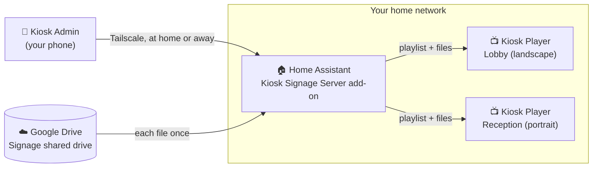
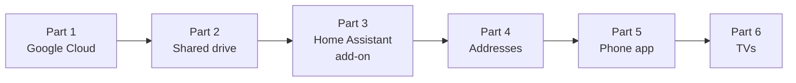
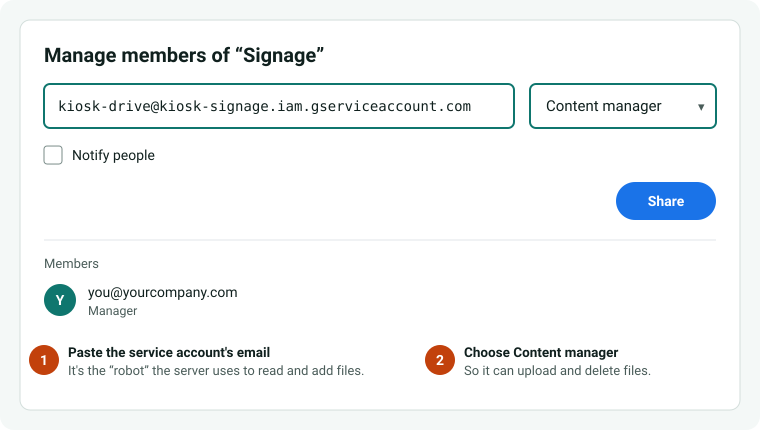
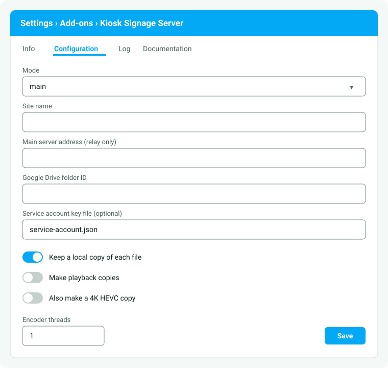
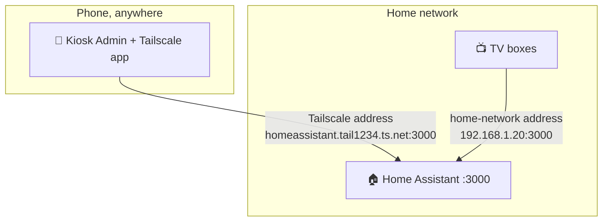
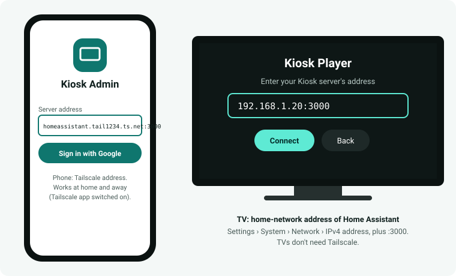
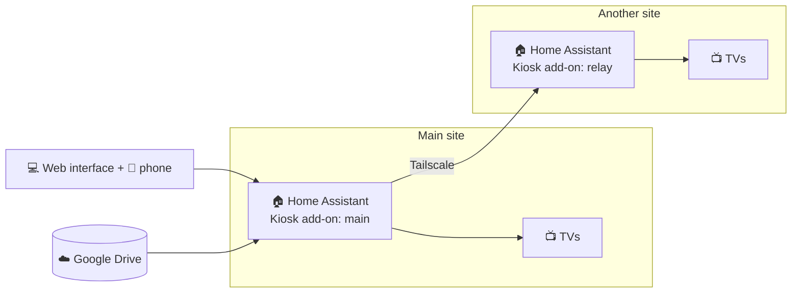

# Kiosk Signage

Digital signage you manage from Home Assistant, a computer, or your phone.

- **Kiosk server** runs as a Home Assistant add-on. It keeps the playlists, screens and users, and passes
  your files from Google Drive to the TVs. It's the one place everything is stored.
- **Web interface, the main control:** in Home Assistant's sidebar, or at `http://<address>:3000` from any
  computer. Every screen at a glance, new TVs waiting to be added, files, playlists, people and settings.
- **Kiosk Admin** runs on your Android phone: the same management on the go.
- **Kiosk Player** runs on Android TV boxes and loops 4K videos and pictures, full screen. It finds the
  server on its own network by itself.
- **Several sites?** One Home Assistant is the main control; the Home Assistants at your other sites
  relay their TVs to it (see [Adding another site](#adding-another-site)).



Your videos and pictures live in a **Google Drive shared drive**. Anything you drop there shows up in the
app's Library. Each TV downloads its playlist and plays from its own storage, so it keeps playing if the
internet drops.

4K videos are kept as they are in Drive. The server also makes smaller copies so a weak Android TV box
can play them smoothly: 1080p H.264 for most boxes, 720p if a box cannot do 1080p, and an optional 4K
HEVC copy for a box that can decode it. Each player reports what it can decode, and downloads the copy
that fits. On a slow Home Assistant machine (a Raspberry Pi), turn **Make playback copies** off.

---

## Setup guide

Allow about an hour the first time. You need:

- a **Google account** whose Drive holds your signage files (a Google Workspace account with a shared drive works best),
- **Home Assistant OS** with the **Tailscale** add-on already working,
- an **Android phone** and one or more **Android TV boxes**,
- a computer, to copy files to Home Assistant.



### Your settings sheet

Fill this in as you go. You'll need these values in Part 3.

| Setting | Where it comes from | Example |
|---|---|---|
| Service account email | Part 1, step 3 | `kiosk-drive@kiosk-signage.iam.gserviceaccount.com` |
| Service account key file | Part 1, step 4 | `service-account.json` (**secret, never share it**) |
| Drive folder ID | Part 2, step 4 | `0AbCdEfGhIjKlMnOpQ` |
| Home network address | Part 4, step 1 | `192.168.1.20:3000` |
| Tailscale address | Part 4, step 2 | `homeassistant.tail1234.ts.net:3000` |

---

### Part 1: Google Cloud (about 10 minutes)

This gives the server a way to read your Drive folder. Signing in to Kiosk doesn't involve Google:
people use a username and password you make in Kiosk (Part 3).

1. **Create a project.** Go to [console.cloud.google.com](https://console.cloud.google.com), open the project
   picker at the top, choose **New project**, name it `Kiosk Signage`, and click **Create**. Make sure the
   new project is selected at the top.
2. **Switch on the Drive API.** Go to **APIs & Services → Library**, search for **Google Drive API**,
   open it, and click **Enable**.
3. **Create the robot account (a "service account").** Go to **IAM & Admin → Service accounts →
   Create service account**, name it `kiosk-drive`, click **Create and continue**, skip the optional
   steps, and click **Done**. Copy its **email** into your settings sheet.
4. **Download its key.** Click the service account, open the **Keys** tab, then **Add key → Create new
   key → JSON → Create**. A `.json` file downloads. Rename it to `service-account.json` and keep it
   somewhere safe: it works like a password to your signage Drive. Never send it to anyone or paste it
   into a chat; if that happens, delete the key here and make a new one.

> **If step 4 says key creation is blocked:** your Workspace has a policy that blocks service account keys.
> A Workspace admin can allow it in Cloud Console under **IAM & Admin → Organization policies →
> "Disable service account key creation"** (`iam.disableServiceAccountKeyCreation`), set for this project only.

### Part 2: The Signage shared drive (about 5 minutes)

1. Go to [drive.google.com](https://drive.google.com), open **Shared drives**, click **New**, and name it
   `Signage`.
2. Open it, click its name at the top, choose **Manage members**, and add the **service account email**
   as a **Content manager**. Untick **Notify people**, then click **Share**.

   

3. If Drive says you **can't share outside your organisation**, open the shared drive's **Settings**
   (the same menu) and allow **people outside your organisation**. If that option is greyed out, a
   Workspace admin can switch it on in **admin.google.com → Apps → Google Workspace → Drive and Docs →
   Sharing settings**.
4. Look at the web address while you're inside the shared drive:
   `https://drive.google.com/drive/folders/`**`0AbCdEfGhIjKlMnOpQ`**. The last part is the **Drive
   folder ID**. Copy it into your settings sheet.
5. Drop one test video (`.mp4`) and one picture (`.jpg` or `.png`) into it.

### Part 3: The Home Assistant add-on (about 10 minutes)

1. **Add the Kiosk add-on repository.** In Home Assistant, go to **Settings → Add-ons → Add-on store**,
   open the **⋮** menu (top right) and choose **Repositories**. Paste this address, click **Add**, then
   **Close**:

   ```
   https://github.com/hybrid87sg/kiosk-addons
   ```

2. **Install it.** Refresh the page, find **Kiosk Signage Server** in the store, open it and click
   **Install**. Home Assistant downloads the add-on ready-made, so this takes about a minute.
3. **Fill in the Configuration tab** with the values from your settings sheet, then click **Save**:

   

   Leave **Mode** as `main`. **Site name** is optional (e.g. `Head office`); it matters once you
   [add another site](#adding-another-site). Leave **Service account key file** as it is.
4. Go back to the **Info** tab, switch on **Start on boot**, **Watchdog** and **Show in sidebar**, and click
   **Start**. The **Log** tab should end with `Kiosk server running on port 3000`.
5. **Add the Google key.** Open **Kiosk Signage** in Home Assistant's sidebar and go to
   **Settings → Google key**. Choose **Upload the file** and pick `service-account.json`, or choose
   **Paste the text** and paste everything that's in the file. The key stays on your Home Assistant and
   is never shown again.
6. **Share the Drive folder with the server.** The same card now shows the service account's email. If you
   haven't already (Part 2, step 2), share your signage folder with that email as **Editor**
   (**Content manager** on a shared drive). Then press **Test connection** under **Google Drive folder**:
   it should say `✓ Connected`.

7. **Make your own username.** Still in Kiosk Signage, go to **Users → Add someone**. Type a username,
   a password of at least 8 characters, and choose **Spongebob** (everything). This is what you sign in
   with on the phone. The sidebar page itself never asks: your Home Assistant login covers it.

> **Prefer a file?** You can instead copy `service-account.json` into the **addon_configs** share (via the
> **Samba share** add-on), in the folder ending in **`_kiosk_server`**. A key added on the Settings page is
> used instead of that file.

### Part 4: The two addresses (about 5 minutes)

Your phone and your TVs reach the server in different ways:



1. **Home-network address (TVs, as a backup).** TVs normally find the server by themselves, and find it
   again if the router gives it a new address. Just in case, in Home Assistant go to
   **Settings → System → Network** and note the **IPv4 address** (e.g. `192.168.1.20`). The address to
   type is that plus `:3000`.
2. **Tailscale address, for the phone.** In the
   [Tailscale admin console](https://login.tailscale.com/admin/machines), find your Home Assistant machine.
   Copy its **MagicDNS name** (e.g. `homeassistant.tail1234.ts.net`) or its `100.x.y.z` address. The
   phone address is that plus `:3000`.
3. **Quick test.** On your phone, with the Tailscale app switched on, open the browser and go to
   `http://homeassistant.tail1234.ts.net:3000/api/health` (using your own name). It should say
   `{"ok":true}`.

### Part 5: The phone app (about 5 minutes)

1. From [**Releases**](https://github.com/hybrid87sg/kiosk-player/releases), download
   `KioskAdmin-for-phone.apk` **on your phone** and open it. Allow **Install unknown apps** when Android
   asks.
2. Open **Kiosk Admin**, enter the **Tailscale address** (e.g. `homeassistant.tail1234.ts.net:3000`),
   then the **username** and **password** you made in Part 3, step 7, and tap **Sign in**.

   

3. **Library** shows your test files, sorted into **Landscape** and **Portrait**.
4. **Add a location**, the place your screens are in, e.g. `Main lobby`: on the web page, **Locations →
   Add location**. It gets two playlists made for it, **Landscape** and **Portrait**, and every screen
   there plays the one that fits how it is mounted. Open **Landscape**, click **Add from library**, then
   **Save playlist**. (On the phone, they are on the **Playlists** tab.)

### Part 6: The TVs (about 5 minutes per TV)

1. Install `KioskPlayer-for-TV.apk` on the screen itself if it runs Android TV or Google TV (e.g. Xiaomi TVs,
   many SWOSH TVs and commercial displays), otherwise on an Android TV box plugged into it. You can:
   - copy it on a USB stick and open it with a file manager app, or
   - use the **Send Files to TV** app on your phone and the TV, or
   - install it from a computer over ADB (`adb install KioskPlayer-for-TV.apk`).
2. **Let it keep itself on screen.** On Kiosk Player's first screen, choose
   **Allow display over other apps** and switch it on for Kiosk Player. With this, the player starts by
   itself when the box is switched on, and comes back 30 seconds after someone presses Home or opens another
   app. Staff can switch this off, or pick **Leave for 15 minutes**, under **Settings** (press **OK** on
   the remote while it plays).
   - On Google TV the menu is **Settings → Apps → Special app access → Display over other apps**.
   - If your TV box hides that menu, run this from a computer instead:
     `adb shell appops set com.kiosk.player SYSTEM_ALERT_WINDOW allow`

   **Optional: let it switch the screen off after hours.** In Kiosk Player's **Settings**, choose
   **Allow turning the screen off** and confirm. Outside the location's working hours the player then puts
   the TV into standby where it can, and wakes it at opening time (see
   [Working hours](#working-hours-and-after-hours)). If the TV hides that screen, run from a computer:
   `adb shell dpm set-active-admin com.kiosk.player/.ScreenOffAdmin`
3. Choose **Find my server automatically**. After a few seconds the TV shows a big **QR code** and a
   **code**. (If it finds nothing, choose **Type the address** and enter the home-network address from
   Part 4, e.g. `192.168.1.20:3000`.)
4. On the web interface (**Kiosk Signage** in Home Assistant's sidebar), the TV appears under
   **New screens waiting** with its model name and code. Click **Add**, then set it up:
   - its **name** and its **location** (required: that is where its playlist and working hours come from),
   - **how the screen is mounted**: landscape, landscape upside down, or portrait turned left or right,
   - its **playlist**. Leave it on **Automatic** and the screen plays its location's Landscape or
     Portrait playlist, whichever fits. To show something different on one screen, add an **extra
     playlist** for the location under **Locations** and choose it here.

   Click **Add screen**. On your phone, **Players** shows the same **New TVs waiting** list; you can also
   **Scan QR code** or **Enter code instead**.
5. The TV shows **Getting content ready**, downloads its files, and starts playing.

### The web interface (the main control)

Everything you can do in the phone app, and more, from any computer. There are two ways in:

| Where | Who can use it | How to sign in |
|---|---|---|
| **Kiosk Signage** in Home Assistant's sidebar | Home Assistant admins (as Spongebob) | Already signed in through Home Assistant |
| `http://<address>:3000` in any browser. The add-on's **Open web UI** button opens it too. | Anyone you made a user for, with their role. They don't need a Home Assistant account. | **Sign in** with their Kiosk username and password. |

**Which address?** At home, the home-network address (`http://192.168.1.20:3000`). Away from home, the
Tailscale address (`http://homeassistant.tail1234.ts.net:3000`). For someone outside your network, install
the **Tailscale** app on their computer, then in the
[Tailscale admin console](https://login.tailscale.com/admin/machines) open your Home Assistant machine's
**⋯** menu, choose **Share…**, and invite their email. They can reach the Kiosk web page, but they still
can't get into Home Assistant itself without a Home Assistant login.

What's on it:
- **Screens:** every TV at a glance (online or offline, what's playing, download progress, free storage),
  updated every 10 seconds and grouped by location, with each location's working hours. New TVs
  appear under **New screens waiting**; click **Add**. **Add by code** is there too.
- **Locations:** one block per location, with its **playlists**, its **working hours** and its screens.
  Every location is also listed in the side menu; open one to rename it or **move a screen here**.
  **+ Add location** makes a new one.
  **Delete location** asks you to type the location's name, and only works once no screens are left in it.
- **Library:** drag files from your computer onto the page to upload them.
  - **Show from / until:** click a file's calendar button (or pick dates before uploading) to choose the
    first and last day it shows. Before the first day it waits in the library (TVs download it a day early,
    so it starts on time). After the last day it leaves Kiosk, every playlist and every screen by itself.
  - **Remove** takes a file out of Kiosk straight away.
  - Expired and removed files wait under **Expired and removed**, where **Restore** brings them back.
  - **Kiosk never deletes anything from Google Drive.** Removed and expired files stay in the shared drive;
    tidy it up there yourself whenever you like.
- **Playlists** live under **Locations**. Each location has an automatic **Landscape** and **Portrait**
  playlist that its screens follow by themselves, plus any **extra playlists** you add for a screen that
  should show something different. The automatic two can't be renamed or deleted; you change what's in
  them. Locations are one list for all your sites: a screen is in a location whichever Home Assistant it
  connects through. A playlist that belongs to no location (from an older version, or left by a deleted
  location) is listed under **Playlists without a location**, to move or delete.
- **In a playlist:** drag rows to reorder them, and optionally set an inclusive start/end date window for each file.
  Dates use the browser's local timezone; players include files only during that window.
- **Settings** (Spongebob): pick who gets **notifications** when a screen goes offline, change the Drive
  folder and test the connection, switch local copies on or off and clear them, and check which sign-in
  methods are set up.

The **‹** button next to the name folds the side menu down to icons; it's remembered in that browser.

### Working hours and after hours

Each location can have working hours (Locations → a location → **Working hours**): opening and closing
times per day, days it's closed, or **Always on**. A closing time earlier than the opening time runs past
midnight (e.g. 18:00 to 02:00). Each TV uses its own clock, so it keeps to the hours even if the internet
drops.

Outside working hours the screens show **black**, and where possible go into **standby**:

| Your screen | What to do |
|---|---|
| **Xiaomi TV** (Android TV / Google TV built in) | Install Kiosk Player on the TV. Allow **turning the screen off** (Part 6, step 2); many such TVs then go into standby after hours. |
| **SWOSH TV** | If its home screen says Google TV or Android TV, as for Xiaomi. If not, plug in an Android TV box (e.g. Xiaomi Mi Box) and use the box. |
| **Commercial display** | If it can install apps (Android inside), install directly. For real power saving, also set the display's own **on/off timer** in its menu to match the working hours. |
| **Any TV with an Android TV box** | Allow **turning the screen off** on the box, and switch on **HDMI-CEC** on the TV (Samsung: Anynet+, LG: SIMPLINK, Sony: BRAVIA Sync, others: CEC). The TV then follows the box into standby and back on. |

Screens that can't go into standby simply stay black after hours. Screen cards show **After hours ·
standby** or **After hours · black screen** so you can see which is which.

### Notifications when a screen goes offline

Home Assistant can tell your phone when a screen stops working:

1. Install the **Home Assistant** app on your phone and sign in to your Home Assistant. (It adds a
   `notify.mobile_app_…` service for the phone.)
2. In the Kiosk web interface, go to **Settings → Notifications**, tick your phone (and anyone else's), and
   click **Send a test notification**.

You get one notification when a screen has been offline for **5 minutes during its location's working
hours** (several at once are grouped; a whole site going quiet is reported as that site), and another
when it's **back online**. Nothing is sent outside working hours. Tapping it opens Kiosk Signage in the
Home Assistant app.

### Adding another site

Have Home Assistants at other places too? Keep **one** of them as the main control. At each other site,
the Kiosk add-on runs as a **relay**: that site's TVs talk to their own Home Assistant, which passes
everything on to the main one over Tailscale. Every screen, at every site, shows up in the one web
interface, and you use one user list, one library and one list of locations. Each location has its own
Landscape and Portrait playlist, so two places can show different things.



Each video crosses the internet once per site. The relay keeps its own copy and sends it to that site's
TVs over the local network. If a site's internet goes down, its TVs keep playing what they have.

1. **On the main Home Assistant:** in the Kiosk add-on's **Configuration** tab, set **Site name**
   (e.g. `Head office`). Note its Tailscale `100.x.y.z` address
   ([admin console](https://login.tailscale.com/admin/machines)).
2. **At the new site, install Tailscale.** Install the **Tailscale** add-on in that site's Home Assistant
   and log in with the **same Tailscale account** as the main site. Sharing a machine in from a different account isn't enough: a shared machine can't start connections, and a relay has to. In the Tailscale add-on's **Configuration**, turn
   **userspace networking** off, so other add-ons can use Tailscale too, then restart it.
3. **Install the Kiosk add-on there** (Part 3, steps 1–2). You don't need the Google settings or the key
   file there. In **Configuration**, set:
   - **Mode**: `relay`
   - **Site name**: e.g. `Orchard branch`
   - **Main server address**: the main Home Assistant's Tailscale address plus `:3000`,
     e.g. `100.101.102.103:3000`
4. **Start it.** Its sidebar page shows **Connected** when it can reach the main server.
5. **Add that site's TVs** as in Part 6. They find their local relay by themselves, and appear on the main
   web interface under **New screens waiting**, labelled with the site.

### Adding other people

In the web interface or Kiosk Admin, go to **Users → Add someone**. Give them a **username**, a
**password** of at least 8 characters, and a role:

| Role | Can do |
|---|---|
| **Spongebob** | Everything, including people and roles |
| **Patrick** | Players and content |
| **Squidward** | Files and playlists |

Tell them their username and password yourself; Kiosk keeps passwords scrambled and can't show one
again. They can use the web interface from their computer (see above), or install the phone app the
same way, connect with Tailscale, and sign in.

- **Forgotten password:** Spongebob gives them a new one under **Users → New password**. If Spongebob's
  own is forgotten, open Kiosk Signage from Home Assistant's sidebar (which needs no Kiosk password) and
  set a new one there.
- **Five wrong passwords** lock that username for five minutes.
- **Removing someone** signs them out straight away.
- On the same Wi-Fi as the server, passwords travel unencrypted, as with most home-network devices. Over
  Tailscale they are encrypted. Use passwords you don't use anywhere else.

### Troubleshooting

| What you see | What to do |
|---|---|
| Add-on log: `Missing settings: …` | Fill in those boxes on the **Configuration** tab, then **Save** and **Start**. |
| Library is empty, or says `The Google key hasn't been added yet` | Add the key under **Settings → Google key** (upload or paste). |
| Library says `Google can't find the Drive folder` | Check the folder ID under **Settings**, and share the folder with the email shown on the **Google key** card, as **Editor**. |
| Phone: "Can't reach the server" | Is the Tailscale app on? Does `…:3000/api/health` open in the phone's browser? |
| Phone: "This server is older than this app" | Update the Kiosk add-on in Home Assistant to 0.6.0 or newer. |
| Phone or web: "Wrong username or password" | Usernames are lower case. Spongebob can set a new password under **Users → New password**. |
| "Too many wrong passwords" | Wait five minutes, or have Spongebob set a new password, which clears it. |
| A screen shows nothing and says "No location yet" | Edit the screen and choose its location; its playlist comes from there. |
| Library says "Could not reach Google Drive" | Check the Drive folder ID, and that the service account is a **Content manager** on the shared drive. |
| A screen is black during the day | Check its location's **working hours** (Locations), and that the TV's clock and time zone are right. |
| A TV doesn't wake up at opening time | Allow **turning the screen off** again in Kiosk Player's Settings, switch on HDMI-CEC on the TV (with a box), or use the display's own on/off timer. You get a notification 5 minutes after opening if it stays offline. |
| No offline notifications | **Settings → Notifications**: tick a device and **Send a test notification**. The phone needs the Home Assistant app, signed in. |
| Can't delete a location | Move its screens to another location first, and type its name exactly. |
| A file disappeared from the library or the screens | It probably expired or was removed: see **Library → Expired and removed**, and **Restore** it. |
| A file shows **Checking shape…** | Drive is still processing a new video; it sorts itself within a few minutes. |
| TV says "No server found" | Is the Kiosk add-on running, and is the TV on the same network as Home Assistant (not a guest Wi-Fi)? Or choose **Type the address**. |
| TV shows "Can't reach the server" | If you typed an address, it must be the **home-network** one, not the Tailscale one. The TV also searches again by itself after 2 minutes. |
| Relay page says it can't reach the main server | The page says which it is. **No answer:** both Home Assistants must be in the **same Tailscale account** (a machine that was only *shared* in from another account can't start connections), both online in Tailscale, and userspace networking off in the relay site's Tailscale add-on. **Nothing listening:** start the Kiosk add-on at the main site; the address is the main site's Tailscale address plus `:3000`. |
| Phone: "This is the relay for …" | Sign in with the **main** Home Assistant's address; relays only serve their TVs. |
| TV doesn't come back after Home, or doesn't start after a power cut | Give Kiosk Player the **Display over other apps** permission (Part 6, step 2), and check **Settings → Come back to the front** is on. |

---

## For developers

| Folder | What's inside |
|---|---|
| [`server/`](server) | Node.js + Express + SQLite API (`npm test` runs the end-to-end tests) |
| [`homeassistant/`](homeassistant) | The Home Assistant add-on; `package-addon.sh` builds the add-on folder |
| [`android/`](android) | `core` (shared Kotlin, `./gradlew :core:test`), `admin` (phone app), `player` (TV app) |
| [`.github/workflows/`](.github/workflows) | Builds and checks on every push; **Release** publishes the APKs and the add-on |

**To publish a release:** go to **Actions → Release → Run workflow** and enter a version (e.g. `0.4.0`).

The APKs are test builds signed with the shared test key in `android/keystore`. Make a private
release key before publishing anywhere public.
