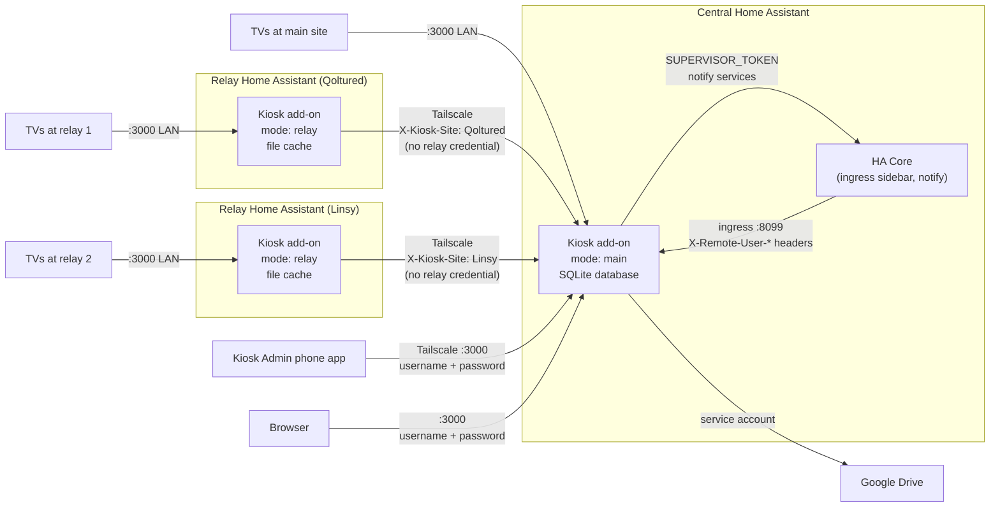
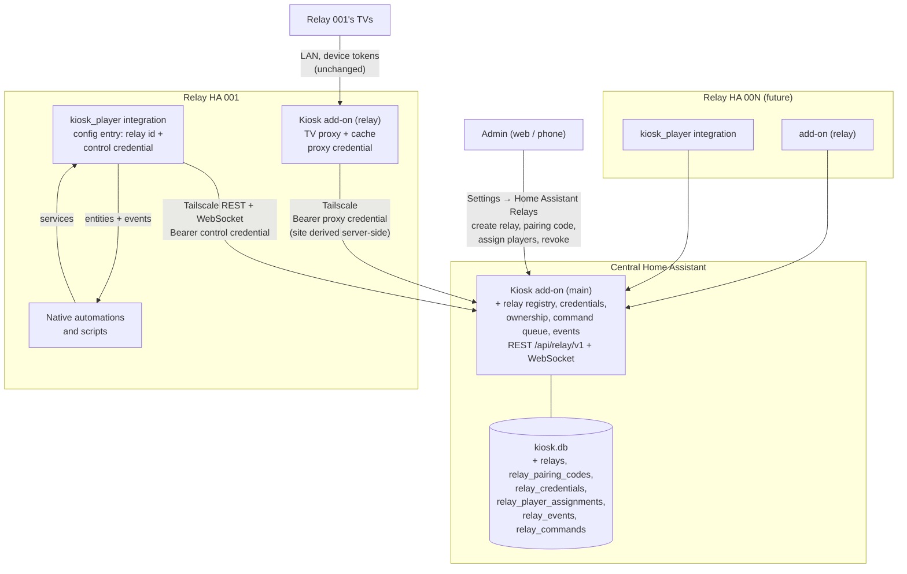

# Multi-location relays and the `kiosk_player` Home Assistant integration: audit and plan

**Status:** Stage 1 (audit and planning) done. No application code has changed. The owner
answered decisions D1–D5 on 13 Nov 2026 (see [§9](#9-decisions)). Implementation starts with
Stage 2 once the owner approves the plan.

**Audited:** `hybrid87sg/kiosk-player` at `fd15560` (main, release v0.6.0) and
`hybrid87sg/kiosk-addons` at `cd7efda` (add-on 0.6.0). Also noted: the open branch
`docs-0.6.0-cleanup` (Cursor Agent, README and setup images only, not merged) and draft PR #28
(planned overlays).

---

## 1. Audit: what exists today

### 1.1 Components

| Component | Where | What it is |
|---|---|---|
| Kiosk server | `server/` (Node 22, Express 5, better-sqlite3) | One process, two modes: **main** and **relay**, chosen in the add-on's Configuration tab (`mode`). |
| Main mode | `server/src/app.js` (1,580 lines) | Database, Google Drive library, playlists, locations, users, TVs, web interface, HA notifications, optional ffmpeg playback copies. |
| Relay mode | `server/src/relay.js` (299 lines) | A **TV proxy** for another site: forwards `/api/player/*` and `/media/:id` to the main server, keeps a local file cache, shows a status page. No database, no users. |
| Web interface | `server/public/app.js` (1,650 lines), `index.html`, `relay.html` | Served on port 3000 and through HA ingress (port 8099). |
| HA add-on | `homeassistant/kiosk_server/` (`config.yaml`, `DOCS.md`, `Dockerfile`) | Built for amd64 and aarch64, published to `ghcr.io/hybrid87sg/kiosk-server:<version>`. |
| Add-on store | `hybrid87sg/kiosk-addons` | Generated by `homeassistant/package-addon.sh`: `repository.yaml`, README, and the add-on's `config.yaml` with an `image:` line. There is no code in it. |
| Phone app (Kiosk Admin) | `android/admin` + `android/core` | Signs in with server address, username and password (0.6.0). |
| TV app (Kiosk Player) | `android/player` + `android/core` | Registers, is claimed with a pairing code or QR, then polls. |
| CI | `.github/workflows/` | `server.yml` (npm test), `addon.yml` (build both architectures, start it, check main and relay mode, publish on request), `android.yml`, `release.yml`. |

**There is no Home Assistant integration (Python) in either repository today.** The only HA
touchpoints are the add-on, ingress, and `homeassistant_api` (the add-on calls HA's notify services).

### 1.2 How things are deployed now (matches the owner's setup)



### 1.3 Authentication paths (all of them)

| Caller | How it proves who it is | Code |
|---|---|---|
| Phone app and web on port 3000 | `POST /api/auth/login` (username + password, scrypt hash, 5 tries then 5-minute lock), then `Authorization: Bearer <session token>`. Sessions last 30 days. | `app.js` 264–325, `auth.js` |
| HA sidebar (ingress) | Port 8099 accepts only `172.30.32.2` (the Supervisor). The `X-Remote-User-*` headers make the caller a **superadmin** with no Kiosk login. The add-on sets `panel_admin: true`, so HA shows the panel only to HA admins. | `app.js` 1561–1571, `auth.js` `homeAssistantUser` |
| TV | `POST /api/player/register` (no auth) returns a device token. An admin claims it with the pairing code. After that, `Authorization: Bearer <device token>` on `/api/player/*` and `/media/:id`. | `app.js` 1379–1531, `auth.js` `requireDevice` |
| Relay add-on | **No credential.** It forwards TV requests and sets the `X-Kiosk-Site` header to its configured site name. It checks a TV's token by asking the main server, and caches the answer for 5 minutes. | `relay.js` 145–260 |
| Google | Google is used **only** for Drive, through a service account key. Google sign-in was removed in 0.6.0, at the owner's request. | `google.js` |

Roles: `superadmin` (Spongebob), `system_manager` (Patrick), `content_uploader` (Squidward), set in
`auth.js` (`CAN_MANAGE_CONTENT`, `CAN_MANAGE_DEVICES`, `CAN_MANAGE_USERS`).

### 1.4 The TV ("player") protocol

| Endpoint | Purpose |
|---|---|
| `POST /api/player/register` | New token + 6-character pairing code. Stores `site` from `X-Kiosk-Site`. |
| `GET /api/player/status` | "Have I been claimed?" Unclaimed TVs poll this. |
| `POST /api/player/heartbeat` | **Every 60 s.** Sends what's playing, free space, app version, download progress, time zone, after-hours mode, decoder capabilities and last playback error. Returns the current playlist `version`. Updates `last_seen` and `site`. |
| `GET /api/player/playlist` | Fetched when the version changes. Contains items, upcoming files (next 24 h), location hours, orientation, `flipped`, playlist name. |
| `GET /media/:id` | File download (or a playback copy), with range requests. |

**What the server can make a TV do today:** change its playlist (pin to an extra playlist or back
to Automatic), change orientation, change location (and therefore working hours and playlist), and
force a re-sync (any change bumps `config_version`). A TV picks up a change at its **next heartbeat
(up to 60 s)**. There is **no push channel to TVs**, no "show announcement" (only planned, in PR #28),
and no remote screen on/off. Screen off is local: the TV goes black or into standby outside its
location's working hours.

### 1.5 Database (`server/src/db.js`)

- SQLite file `<data>/kiosk.db`, WAL journal mode, foreign keys on.
- Tables: `users`, `sessions`, `media`, `playlists`, `playlist_items`, `devices`, `locations`,
  `app_settings`, `renditions`.
- Later columns are added with `addColumnIfMissing` (additive, keeps data): `users.password_hash`,
  `playlists.location_id`, `playlists.auto`, `devices.site`, `devices.flipped`, and more.
- **Destructive mechanism (confirmed):** `SCHEMA_VERSION = 3`. If `PRAGMA user_version` is lower,
  `openDatabase` **drops** `sessions, users, playlist_items, devices, playlists, media, settings`.
  `user_version` is 3 on every current install. **It must never be raised.** All new tables must be
  `CREATE TABLE IF NOT EXISTS` plus `addColumnIfMissing`.
- One-time data changes are guarded by flags in `app_settings` (`playlists_by_site`,
  `playlists_by_location`). This pattern continues.

### 1.6 Sites, locations and "ownership" today

- `devices.site` is whatever `X-Kiosk-Site` said at the TV's last heartbeat. With no header, it is
  the main server's own site name.
- `locations` is one list for the whole system (0.6.0). A screen is in the location named in
  `devices.location`. Playlists belong to locations.
- **Nothing ties a TV to a relay securely.** Any machine that can reach port 3000 on the main server
  (anything on the Tailscale network, or on the main site's LAN) can send any `X-Kiosk-Site` value. A
  TV's site changes to whatever the header says at its next heartbeat.

### 1.7 Tests

- `server/test/`: 56 tests (37 API, plus playback copies). They use a fake Google, temp databases,
  and real HTTP. Patterns exist for older-database upgrades (`oldInstall()`), ingress and relays.
- `android/core`: 50 unit tests. `android/admin`: 1 reorder test. TV UI has no tests.
- `addon.yml` builds the image and starts it in main and relay mode.

---

## 2. Audit findings that affect this project

| # | Finding | Severity | Plan |
|---|---|---|---|
| F1 | Relays have **no identity or credential**. The `X-Kiosk-Site` header is trusted as given. | High (for this project) | Stage 2 adds relay credentials. The main server stops trusting the header from unauthenticated callers. |
| F2 | `SCHEMA_VERSION` bump wipes data. | High (if touched) | Never raise it. Additive migrations only, with a test against a copied 0.6.0 database. |
| F3 | HA ingress = superadmin with no Kiosk login. It is also the documented **password recovery** path (0.6.0). | Needs a decision | See [D2](#9-decisions). |
| F4 | The handover asks for **Google web authentication for the public dashboard**. Google sign-in was **removed** in 0.6.0 at the owner's request. Nothing is exposed with Tailscale Funnel today. | Needs a decision | See [D1](#9-decisions). |
| F5 | No push channel to TVs. Commands take up to 60 s. | Design constraint | Commands go to the central server and are acknowledged when the TV picks them up. No new TV protocol in this project unless approved. |
| F6 | "Show announcement" and "screen control" don't exist on the TV. | Design constraint | Not exposed as services until the TV supports them (see [D4](#9-decisions)). |
| F7 | Each relay HA will run **two** Kiosk pieces: the existing add-on (TV proxy) and the new integration (control). | Design | One relay record, one pairing, and two credentials (see [§4](#4-database-migration-design)). |
| F8 | The add-on's port 3000 serves both the TV protocol and the web UI on every interface. | Medium | Stage 2 keeps it. Relay APIs live under `/api/relay/v1`, and Funnel (if used) must point at a path-restricted proxy (see [D1](#9-decisions)). |
| F9 | `/media/:id` serves any media to any claimed device (already noted in issue #22). | Low | Out of scope. Relay ownership checks will not widen it. |

---

## 3. Target architecture



Principles:

- **The central server is the only authority.** Relays never touch the database. Every relay request
  is checked: valid credential, relay enabled, and the player is owned by this relay.
- **The TV protocol does not change.** TVs keep their device tokens and talk to their local relay
  add-on, which forwards to the main server as today.
- **Relays are not numbered or limited.** Relay ids are random (`rly_` + 16 bytes base32). Nothing
  assumes two.
- **Old relay add-ons keep working during the upgrade** (see [§7](#7-compatibility-risks), R3).

---

## 4. Database migration design

All additive, in `db.js`, after the existing `CREATE TABLE IF NOT EXISTS` block. `SCHEMA_VERSION`
stays 3.

```sql
-- One per relay Home Assistant. The id is generated by the central server and is not sequential.
CREATE TABLE IF NOT EXISTS relays (
  id            TEXT PRIMARY KEY,            -- 'rly_' + random
  name          TEXT NOT NULL,               -- e.g. 'Qoltured'
  site          TEXT NOT NULL UNIQUE,        -- the site name its TVs are recorded under (devices.site)
  location_id   INTEGER REFERENCES locations(id) ON DELETE SET NULL,  -- default location for its new TVs
  description   TEXT,
  status        TEXT NOT NULL DEFAULT 'pending'
                CHECK (status IN ('pending', 'active', 'disabled')),
  created_at    INTEGER NOT NULL,
  created_by    INTEGER REFERENCES users(id) ON DELETE SET NULL,
  paired_at     INTEGER,
  last_seen_at  INTEGER,                     -- any authenticated request or heartbeat
  last_version  TEXT,                        -- integration / add-on version reported
  disabled_at   INTEGER
);

-- Short-lived, single-use. Only a hash is stored.
CREATE TABLE IF NOT EXISTS relay_pairing_codes (
  id          INTEGER PRIMARY KEY,
  relay_id    TEXT NOT NULL REFERENCES relays(id) ON DELETE CASCADE,
  code_hash   TEXT NOT NULL,                 -- HMAC-SHA256(server secret, code)
  expires_at  INTEGER NOT NULL,              -- created + 10 minutes
  used_at     INTEGER,
  created_at  INTEGER NOT NULL
);

-- Long-lived credentials; only a hash is stored. A relay has up to one active 'control' credential
-- (the integration) and one active 'proxy' credential (the add-on).
CREATE TABLE IF NOT EXISTS relay_credentials (
  id           TEXT PRIMARY KEY,              -- 'rcr_' + random, shown in diagnostics, not secret
  relay_id     TEXT NOT NULL REFERENCES relays(id) ON DELETE CASCADE,
  kind         TEXT NOT NULL CHECK (kind IN ('control', 'proxy')),
  secret_hash  TEXT NOT NULL,                 -- SHA-256 of a 32-byte random secret
  created_at   INTEGER NOT NULL,
  last_used_at INTEGER,
  revoked_at   INTEGER,
  revoked_reason TEXT
);

-- Which relay owns which TV. One primary owner per TV, enforced by the primary key.
-- History is kept in relay_events, not here.
CREATE TABLE IF NOT EXISTS relay_player_assignments (
  device_id    INTEGER PRIMARY KEY REFERENCES devices(id) ON DELETE CASCADE,
  relay_id     TEXT NOT NULL REFERENCES relays(id) ON DELETE CASCADE,
  assigned_at  INTEGER NOT NULL,
  assigned_by  INTEGER REFERENCES users(id) ON DELETE SET NULL  -- null = automatic (see below)
);

-- An audit trail: pairing, credential use and revocation, assignments, connection changes,
-- commands and their results, player online/offline. Pruned after 90 days.
CREATE TABLE IF NOT EXISTS relay_events (
  id         INTEGER PRIMARY KEY,
  relay_id   TEXT REFERENCES relays(id) ON DELETE SET NULL,
  device_id  INTEGER,
  kind       TEXT NOT NULL,                  -- e.g. 'paired', 'credential_revoked', 'command_acked'
  detail     TEXT,                           -- JSON, never secrets
  actor      TEXT,                           -- 'user:<id>', 'relay:<id>', 'system'
  created_at INTEGER NOT NULL
);

-- Commands from a relay (or later the web UI) waiting for a TV, so they can be acknowledged
-- and expire.
CREATE TABLE IF NOT EXISTS relay_commands (
  id          TEXT PRIMARY KEY,              -- 'cmd_' + random, also the idempotency key
  relay_id    TEXT NOT NULL REFERENCES relays(id) ON DELETE CASCADE,
  device_id   INTEGER NOT NULL REFERENCES devices(id) ON DELETE CASCADE,
  kind        TEXT NOT NULL,                 -- 'play_playlist', 'refresh'
  payload     TEXT,                          -- JSON
  status      TEXT NOT NULL CHECK (status IN ('queued', 'applied', 'acknowledged', 'expired', 'rejected')),
  created_at  INTEGER NOT NULL,
  applied_at  INTEGER,                       -- server changed the TV's settings
  acked_at    INTEGER,                       -- the TV fetched the new playlist version
  expires_at  INTEGER NOT NULL
);
CREATE INDEX IF NOT EXISTS relay_events_by_relay ON relay_events (relay_id, created_at);
CREATE INDEX IF NOT EXISTS relay_commands_by_device ON relay_commands (device_id, status);
```

Plus one setting: `app_settings.relay_hmac_secret`, a random 32 bytes created once and used to hash
pairing codes.

**Existing data, one time** (guarded by `app_settings.relays_adopted`): for each distinct
`devices.site` that isn't the main server's own site, create a `relays` row with `status = 'pending'`
and that `site`. Assign its TVs to it (`assigned_by = NULL`). Nothing is deleted and no existing
column changes. Until a relay is paired, its TVs keep working exactly as today.

**Recovery and rollback:**

1. Before the upgrade, the add-on is backed up with Home Assistant's normal backup (Settings →
   System → Backups → *Kiosk Signage Server* add-on). The upgrade instructions say so first.
2. The upgrade only adds tables and columns. Rolling the add-on back to 0.6.0 leaves them unused and
   harmless, because 0.6.0 ignores unknown tables.
3. Recovering from a lost relay credential: an admin rotates or revokes it in the dashboard and
   re-pairs the relay with a new code. No database edits are needed.

**Migration test:** a 0.6.0 `kiosk.db` with users, sessions, playlists, media, TVs from two sites and
device tokens is copied, opened by the new server, and checked:

- every row is still there;
- every session and device token still works;
- the relays and assignments have been created;
- a second start changes nothing.

---

## 5. API specification (central server)

All relay endpoints are under `/api/relay/v1`. They are separate from the existing
`/api/relay/status`, which is the relay add-on's own page and stays as it is. JSON in and out. Errors
are `{ "error": "<sentence>", "code": "<machine_code>" }`.

### 5.1 Admin endpoints (session or ingress auth, `superadmin` only)

| Method and path | Purpose |
|---|---|
| `GET /api/relays` | List relays: status, last seen, connected (WebSocket), player counts, active credential ids. |
| `POST /api/relays` `{name, site?, location_id?, description?}` | Create. Returns `{relay, pairing_code, expires_at}`. The code is shown once. |
| `POST /api/relays/:id/pairing-code` | New code (invalidates any unused one). |
| `PATCH /api/relays/:id` `{name?, description?, location_id?, status: 'active' \| 'disabled'}` | Edit, disable or enable. Disabling closes its WebSocket and refuses every credential. |
| `POST /api/relays/:id/credentials/:cid/revoke` | Revoke one credential and close its sockets. |
| `POST /api/relays/:id/rotate` `{kind}` | Issue a new credential to the **connected** relay over its WebSocket and revoke the old one once the relay confirms. |
| `GET /api/relays/:id/events?before=&limit=` | History. |
| `PUT /api/devices/:id/relay` `{relay_id}` | Reassign a TV (system manager or above). Logged. |
| `DELETE /api/relays/:id` `{confirm_name}` | Only with no players assigned. |

### 5.2 Pairing (no auth, rate limited)

`POST /api/relay/v1/pair` `{code, kind: 'control' | 'proxy', client: {name, version, ha_version?}}`

- The code is looked up by HMAC. It must be unused, not expired, and its relay not disabled.
- It returns `{relay: {id, name, site}, credential_id, credential}`, where the credential is shown once:
  `rk_` + base64url(32 random bytes).
- **The code is single-use per kind (D3).** One code pairs both the integration and the add-on, so the
  admin types it twice within 10 minutes, once in each. It becomes invalid when both have used it or
  when it expires.
- **Rate limits:** 10 attempts per minute per source address, and 50 per hour overall. After that,
  answers are 429. Wrong codes all return the same 401.
- Neither codes nor credentials are logged. The request logger redacts `code`, `credential` and the
  `Authorization` header.

### 5.3 Relay endpoints (`Authorization: Bearer rk_…`, checked on every request)

The check runs in this order:

1. Hash and look up the credential.
2. It must not be revoked.
3. The relay must be active, not disabled.
4. The kind must be allowed on this endpoint.
5. Then `relays.last_seen_at` and `relay_credentials.last_used_at` are updated, at most once a minute.

| Method and path | Kind | Purpose |
|---|---|---|
| `GET /api/relay/v1/me` | both | The relay's id, name, site and status. |
| `POST /api/relay/v1/heartbeat` `{version, uptime_s}` | both | Liveness, every 30 s. Returns `{server_time, players_version}`. |
| `GET /api/relay/v1/players` | control | **Only this relay's TVs**: id, name, location, online, last seen, current file, playing playlist, Automatic or pinned, orientation, app version, free space, after-hours state, open now, playback error. |
| `GET /api/relay/v1/players/:id` | control | One TV. **404 if not owned**, never 403, so the existence of other relays' TVs isn't revealed. |
| `GET /api/relay/v1/players/:id/playlists` | control | The playlists this TV may play: its location's Automatic two plus that location's extras. |
| `POST /api/relay/v1/players/:id/commands` `{id?, kind, payload, ttl_s?}` | control | Queue a command (see 5.5). Ownership is checked. Returns the command with its status. |
| `GET /api/relay/v1/commands/:id` | control | Status of one of this relay's commands. |
| `GET /api/relay/v1/ws` (upgrade) | control | WebSocket (see 5.4). |
| `/api/player/*` and `/media/:id`, forwarded by the add-on | proxy | As today, with `Authorization: Bearer rk_…` sent in `X-Kiosk-Relay-Auth`. The **site comes from the credential**, not from `X-Kiosk-Site`. |

### 5.4 WebSocket messages (JSON, one connection per paired integration)

Server to relay:

- `{"type":"hello","relay_id","server_time","resume_after":<event id>}`
- `{"type":"player.updated","player":{…}}`, sent when a heartbeat changes something an entity shows
  (debounced to 5 s).
- `{"type":"player.online"|"player.offline","player_id","at"}`
- `{"type":"command.updated","command":{id,status,…}}`
- `{"type":"credential.rotate","credential_id","credential"}`, which the relay answers with
  `{"type":"credential.rotated","credential_id"}`.
- `{"type":"relay.disabled"}`, sent just before the server closes the connection.
- `{"type":"ping"}` every 25 s. The relay answers `pong`. No answer for 60 s closes the connection.

Relay to server: `pong`, `credential.rotated`, `{"type":"resync"}` (asks for a full player list).

Events carry an increasing id. After a reconnect the relay sends `?after=<id>` and gets anything it
missed from the last 10 minutes. If it was away longer, it does a full `GET /players`.

### 5.5 Commands (only what the TV protocol already supports)

| `kind` | `payload` | What the server does | "Acknowledged" when |
|---|---|---|---|
| `play_playlist` | `{playlist_id}` or `{automatic: true}` | Same as pinning or unpinning in the dashboard: checks the playlist belongs to the TV's location, sets `devices.playlist_id`, bumps `config_version`. | The TV's next heartbeat reports the new version (≤ 60 s). |
| `refresh` | `{}` | Bumps `config_version`, so the TV re-reads its playlist and re-checks files. | Same. |

- `ttl_s` defaults to 300. A command not acknowledged in time becomes `expired`, which the relay sees
  as an event.
- Commands are idempotent by `id`. A newer `play_playlist` for the same TV supersedes an older
  queued one.
- `show_announcement` and `screen_control` are **not offered** until the TV supports them (see
  [D4](#9-decisions)).

---

## 6. Home Assistant integration (`kiosk_player`)

### 6.1 Where it lives

Develop it in this repository, under `homeassistant/integration/custom_components/kiosk_player/`, so
server and integration change together and share CI. At release, publish it to its own HACS
repository, **`hybrid87sg/kiosk-player-ha`** (the owner creates it, like `kiosk-addons`), using a
script similar to `package-addon.sh`. HACS needs `custom_components/kiosk_player/` at the root and a
`hacs.json`.

### 6.2 Files

```
custom_components/kiosk_player/
  __init__.py         setup/unload entry, start API client + WebSocket + coordinator, register services
  manifest.json       domain, name, version, iot_class "local_push", config_flow true,
                      requirements [] (uses HA's aiohttp)
  const.py            domain, defaults, event names
  config_flow.py      user step: central server URL (Tailscale name or 100.x address, :3000 assumed)
                      + pairing code → POST /api/relay/v1/pair → entry data {url, relay_id,
                      credential_id, credential}; reauth flow for a revoked credential; options flow
                      (scan interval fallback)
  api.py              async REST client: auth header, timeouts, errors mapped to ConfigEntryAuthFailed
                      (401) / UpdateFailed
  websocket.py        connect, ping/pong, backoff 1 s → 60 s with jitter, resume-after, credential rotation
  coordinator.py      DataUpdateCoordinator: full player list every 60 s as a fallback; WebSocket
                      pushes update it in between
  entity.py           base entity, device info (one HA device per TV, plus one for the relay)
  sensor.py           relay: connection status, players online, players offline, last heartbeat;
                      player: current playlist, current file, last seen, free storage, app version,
                      playback error
  binary_sensor.py    player: online; relay: central server connected
  button.py           player: refresh
  select.py           player: playlist (Automatic + the location's playlists) → play_playlist
  services.yaml       play_playlist, refresh_player
  services.py         service handlers: target = HA device(s) of TVs; ownership is enforced
                      server-side, and a 404 surfaces as a clear HA error
  diagnostics.py      redacts credential, url host; includes relay id, versions, last events
  strings.json, translations/en.json
hacs.json             (in the published repository)
tests/                pytest-homeassistant-custom-component: config flow, reauth, coordinator,
                      WebSocket reconnect, services, diagnostics redaction
```

**HA events fired:** `kiosk_player_player_online`, `kiosk_player_player_offline`,
`kiosk_player_command_updated`, `kiosk_player_connection_changed`. Automations can trigger on these
or on the entities.

The credential is kept in the config entry's `data`, which HA stores in `.storage`. This is the
standard place for integration secrets; HA has no separate encrypted store. Diagnostics and logs
never include it.

### 6.3 The relay add-on

The add-on gets one new option, `pairing_code` (optional, and cleared after use).

- **Paired:** the add-on sends its proxy credential on every forwarded request, and keeps it in its
  `/data`.
- **Not yet paired:** it keeps working as today. The main server accepts unauthenticated relay
  traffic only while the setting `relays_require_credentials` is off, which is the default until every
  relay is paired (see R3).

---

## 7. Compatibility risks

| # | Risk | Mitigation |
|---|---|---|
| R1 | Raising `SCHEMA_VERSION` wipes data. | Never raised. A test asserts `user_version` stays 3, and a migration test runs on a copied 0.6.0 database. |
| R2 | TV device tokens or phone sessions stop working. | Their tables and columns are untouched. The migration test checks both kinds of token on the copied database. |
| R3 | Relays upgraded at different times. | Unpaired relay add-ons are accepted, as today, until **Settings → Home Assistant Relays → Require relay credentials** is switched on. The dashboard shows which relays are still unpaired. |
| R4 | The `X-Kiosk-Site` header can be spoofed. | Once credentials are required, the header is ignored. The site comes from the proxy credential. TVs connecting to the main server directly are recorded under the main site. |
| R5 | A TV's site changes when it moves between relays (today the next heartbeat moves it). | With credentials, a TV's ownership changes only when an admin reassigns it, or automatically if it is unassigned. A TV showing up through a different relay is logged and flagged in the dashboard, not moved. |
| R6 | Ingress superadmin (see D2). | No change in Stage 2 unless decided. Any change keeps a recovery path. |
| R7 | Google dashboard sign-in (see D1). | Not part of Stages 2–4. Handled as a separate stage after the decision. |
| R8 | Commands take up to 60 s. | Documented. Entities show "pending" until acknowledged. Faster delivery would need a TV protocol change, which is out of scope. |
| R9 | Add-on and integration versions drift. | `/api/relay/v1` is versioned, and `me` returns the server version. The integration raises an HA repair issue if the server is too old. |
| R10 | WebSocket adds a dependency (`ws`) to the server. | Small, widely used. It runs on the same port 3000 server, so there is no new port. |
| R11 | Relay APIs on port 3000 could be exposed by Funnel. | If Funnel is used, it must point at a path filter (D1), never straight at :3000. As a second guard, relay endpoints refuse requests that arrive through a proxy, recognised by the headers Tailscale adds to Funnel traffic (exact header to be confirmed in Stage 2). |
| R12 | Unrelated change creep. | Each stage is its own PR, with only the files listed for that stage. |

---

## 8. Staged plan

Each stage is its own feature branch and draft PR, is tested in CI, and is merged and released only
with the owner's approval. Nothing is deployed to live Home Assistant without approval.

### Stage 2: Multi-relay foundation (server only; add-on 0.7.0)

**Files:**

- `server/src/db.js`: the new tables and the adoption step.
- New `server/src/relays.js`: ids, codes, hashing, credential checks, ownership checks and rate
  limits, as pure functions plus routes.
- `server/src/app.js`: mount the relay routes; check ownership on device endpoints used by relays;
  site from credential when required.
- `server/public/app.js` and `styles.css`: **Settings → Home Assistant Relays**. The list, create
  (shows the code once), new code, disable and enable, revoke, history, assign a player.
- `server/test/relays.test.js` (new) and `server/test/migration.test.js` (new).

**Tests:**

- Code entropy, expiry, single use and per-kind use; brute-force lockout.
- Hashes only, with no secret in the database or logs.
- Credential revoke and disable; ownership 404 for another relay's TV; a simulated relay 003.
- Migration on a copied 0.6.0 database; existing login and TV tests unchanged.

### Stage 3: Relay communication (server + relay add-on; add-on 0.7.x)

**Files:**

- `server/src/relays.js`: heartbeat, players, commands and expiry.
- New `server/src/relay-ws.js`: WebSocket hub, ping/pong, resume, rotation.
- `server/src/relay.js`: the add-on pairs (`pairing_code` option), stores its proxy credential and
  sends it.
- `homeassistant/kiosk_server/config.yaml` and translations.
- `.github/workflows/addon.yml`: pair the relay add-on in CI and check credential-only mode.

**Tests:**

- Two relays connected at once; events reach only the owner.
- Commands applied, acknowledged and expired; the WebSocket drops and resumes.
- Credential rotation; a disabled relay gets disconnected.
- Old unpaired add-on accepted until "require" is switched on, then refused.

### Stage 4: Home Assistant integration (new; integration 0.1.0)

**Files:**

- `homeassistant/integration/…` as in [§6.2](#62-files).
- New `.github/workflows/integration.yml` (pytest + hassfest + HACS validation).
- New `homeassistant/package-integration.sh`.

**Tests:**

- Config flow happy path; wrong code; expired code.
- Reauth after revoke.
- Entities created per TV; select and button call the server.
- Service ownership error.
- Reconnect after the server stops.
- Diagnostics redaction.

### Stage 5: End-to-end testing

The handover's 15 cases are run in CI where possible. A `docker compose` file runs the main server
and two relay servers. The HA integration runs in pytest against the real main server process.
Cases 7–10 (native automation, server outage, Tailscale drop, relay restart) are also written as a
**manual checklist** for the owner's real installations, to be done only with approval.

### Stage 6: Documentation

- README and DOCS: install, pairing, credential recovery, upgrade with backup first, troubleshooting.
- `docs/ha-examples.md`: automations and scripts, for example "switch the lobby screen to the evening
  playlist at 18:00" and "notify when a Qoltured screen goes offline during opening hours".

---

## 9. Decisions

Answered by the owner on 13 Nov 2026.

| | Question | Decision |
|---|---|---|
| D1 | Public dashboard sign-in | **(b) Google sign-in for the web dashboard only.** The phone app keeps its username and password. They are separate sign-in paths. Planned as Stage 7 (below). Stages 2–6 don't depend on it. |
| D2 | HA ingress | **(a) Keep it.** The sidebar stays full (Spongebob) access behind Home Assistant's own admin login, and remains the recovery path. The public dashboard (port 3000 or Funnel) never trusts ingress headers. That is already the case, and Stage 2 adds a test that proves it. |
| D3 | Pairing codes | **One code** per relay, used once by the integration and once by the relay add-on, within 10 minutes. |
| D4 | Announcements and screen control | **Left out of this project.** They will come with the planned overlays work (PR #28). The HA services can be added then. |
| D5 | Integration repository | **`hybrid87sg/kiosk-player-ha`**. The owner creates it when Stage 4 is ready to publish. |

### Stage 7: Google sign-in for the web dashboard (from D1)

- **Who can sign in.** A user record gets an optional linked Google account (`users.google_email`,
  added with `addColumnIfMissing`). Spongebob links it on the Users page. Signing in to the web
  dashboard with Google gives that user's role. A Google account not linked to any user is refused.
- **Separate paths.**
  - The phone app keeps `POST /api/auth/login` (username and password). The web dashboard on the
    public address uses Google only.
  - The plain local address (port 3000 on the home network or Tailscale) can still offer the
    password form. Whether to keep that is to be confirmed at Stage 7.
  - HA ingress is unchanged (D2).
- **How.** The normal Google web sign-in (redirect) flow. It needs an https address, which Tailscale
  Funnel provides. It also needs a Google Cloud "Web application" client with that address as its
  redirect URI (the README's Part 1 grows by two steps again). The returned ID token is checked on
  the server as before 0.6.0: signature, audience, verified email.
- **Funnel.** Funnel points at a small path filter in the add-on that exposes only the dashboard and
  the API calls it uses. It never exposes `/api/relay/v1`, `/api/player/*` or `/media`.
- **Needs from the owner:** the public Funnel hostname, and the Google Cloud web client (step-by-step
  guide provided).
- **Tests:**
  - A linked Google account gets its role; an unlinked one is refused.
  - A password sign-in on the public path is refused, and phone sign-in is unaffected.
  - Ingress headers are ignored on the public path.
  - Relay and player paths aren't reachable through the filter.

## 10. What does not change

- Phone app username and password login.
- TV registration, claiming, device tokens, playlists and file downloads.
- Roles and permissions.
- Playlists, locations, media and Google Drive.
- Add-on installation from `kiosk-addons`.
- The add-on's main and relay modes, and the Home Assistant notifications.
- The relay status page.
